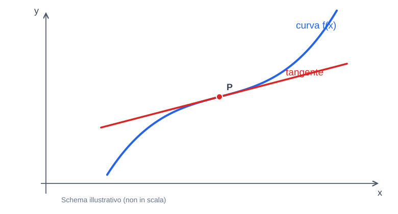
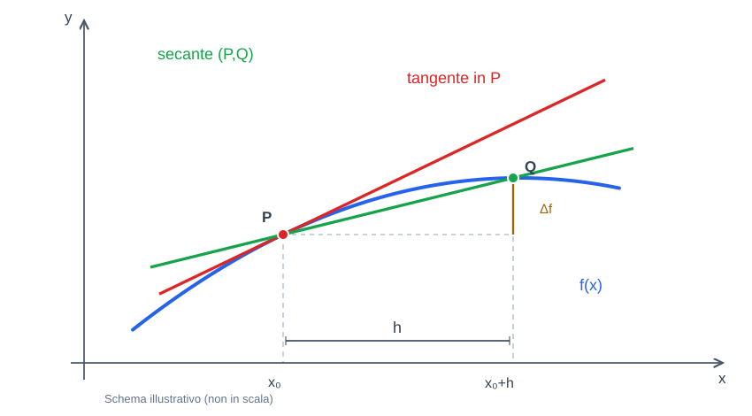

# Derivate

Appunti di **Analisi Matematica 1** — definizioni, proprietà, dimostrazioni essenziali, esempi e formulario delle derivate.

> Materiale organizzato per lo **studio e il ripasso**. I grafici sono schemi esplicativi; la sezione 13 raccoglie le formule di derivazione in una tabella sintetica.

## Indice

1. [Perché nasce la derivata — la retta tangente](#1-perché-nasce-la-derivata--la-retta-tangente)
2. [Definizione di derivata](#2-definizione-di-derivata)
3. [Rapporto incrementale](#3-rapporto-incrementale)
4. [Significato geometrico: dalla secante alla tangente](#4-significato-geometrico-dalla-secante-alla-tangente)
5. [Equazione della retta tangente](#5-equazione-della-retta-tangente)
6. [Riepilogo delle formule](#6-riepilogo-delle-formule)
7. [Retta tangente come migliore approssimante affine](#7-retta-tangente-come-migliore-approssimante-affine)
8. [Primi esempi: derivata di x² e retta tangente](#8-primi-esempi-derivata-di-x²-e-retta-tangente)
9. [Derivabilità e continuità](#9-derivabilità-e-continuità)
10. [Valore assoluto: continua ma non derivabile](#10-valore-assoluto-continua-ma-non-derivabile)
11. [Cuspidi e tangenti verticali](#11-cuspidi-e-tangenti-verticali)
12. [Funzione di Weierstrass: continua ovunque ma mai derivabile](#12-funzione-di-weierstrass-continua-ovunque-ma-mai-derivabile)
13. [Derivate elementari e regole di derivazione — griglia sintetica](#13-derivate-elementari-e-regole-di-derivazione--griglia-sintetica)
14. [Regola del prodotto (Leibniz)](#14-regola-del-prodotto-leibniz)
15. [Regola della catena](#15-regola-della-catena)

## 1. Perché nasce la derivata — la retta tangente

Il calcolo differenziale nasce nel XVII secolo (Newton e Leibniz) anche per affrontare un problema geometrico: **determinare la retta tangente a una curva in un punto**.



- **Curva blu:** grafico della funzione $f(x)$.
- **Punto P:** punto in cui cerchiamo la tangente.
- **Retta rossa:** tangente alla curva nel punto P, con la stessa **inclinazione locale**.
- La tangente **può anche attraversare** la curva: non deve necessariamente limitarsi a toccarla.

## 2. Definizione di derivata

Una funzione è **derivabile nel punto $x_0$** se esiste ed è **finito** il limite del rapporto incrementale:

```math
\boxed{f'(x_0)=\lim_{x\to x_0}\frac{f(x)-f(x_0)}{x-x_0}}
```

Nel rapporto:

- $x_0$ è il **punto fissato** in cui vogliamo calcolare la derivata;
- $x$ è un punto che **si avvicina** a $x_0$;
- $f(x)-f(x_0)$ è la **variazione verticale** della funzione;
- $x-x_0$ è la **variazione orizzontale** della variabile indipendente.

Quando ci si avvicina a $x_0$ da entrambi i lati, i **limiti destro e sinistro del rapporto incrementale** devono coincidere e dare un valore finito.

## 3. Rapporto incrementale

Ponendo $h=x-x_0$, quindi $x=x_0+h$, la stessa definizione si scrive:

```math
\boxed{f'(x_0)=\lim_{h\to 0}\frac{f(x_0+h)-f(x_0)}{h}}
```

Il rapporto incrementale, **prima di calcolare il limite**, è:

```math
\boxed{m_h=\frac{f(x_0+h)-f(x_0)}{h}},\qquad h\ne 0.
```

Qui $h$ misura di quanto cambia l'ascissa rispetto a $x_0$.

## 4. Significato geometrico: dalla secante alla tangente

Consideriamo due punti del grafico:

```math
P=(x_0,f(x_0)),\qquad Q=(x_0+h,f(x_0+h)).
```

La **secante** è la retta che passa per P e Q. Il suo coefficiente angolare è il rapporto incrementale:

```math
m_h=\frac{f(x_0+h)-f(x_0)}{h}.
```



- **Blu:** grafico di $f(x)$.
- **Verde:** secante per i due punti P e Q.
- **Rosso:** tangente in P.
- **$h$:** distanza orizzontale orientata da $x_0$ a $x_0+h$.
- **$\Delta f=f(x_0+h)-f(x_0)$:** variazione verticale.

Quando $h\to0$, Q si avvicina a P. **Se il limite del rapporto incrementale esiste ed è finito**, la pendenza della secante tende a quella della tangente:

```math
\boxed{m_{\mathrm{tangente}}=\lim_{h\to0}m_h=f'(x_0)}.
```

**Idea da ricordare:** la derivata è il **coefficiente angolare della retta tangente**.

## 5. Equazione della retta tangente

L'equazione di una retta che passa per $(x_0,y_0)$ con coefficiente angolare $m$ è:

```math
y-y_0=m(x-x_0).
```

Nel nostro caso $y_0=f(x_0)$ e $m=f'(x_0)$, quindi:

```math
\boxed{y=f(x_0)+f'(x_0)(x-x_0)}.
```

Questa è **l'equazione della retta tangente al grafico** di $f$ nel punto di ascissa $x_0$.

## 6. Riepilogo delle formule

| Oggetto | Formula |
| --- | --- |
| Rapporto incrementale | $\displaystyle m_h=\frac{f(x_0+h)-f(x_0)}{h}$ |
| Derivata nel punto $x_0$ | $\displaystyle f'(x_0)=\lim_{h\to0}\frac{f(x_0+h)-f(x_0)}{h}$ |
| Derivata, forma con $x$ | $\displaystyle f'(x_0)=\lim_{x\to x_0}\frac{f(x)-f(x_0)}{x-x_0}$ |
| Pendenza della tangente | $m=f'(x_0)$ |
| Retta tangente | $y=f(x_0)+f'(x_0)(x-x_0)$ |

## 7. Retta tangente come migliore approssimante affine

Una funzione **affine** è una funzione della forma

```math
y=mx+q.
```

Fra tutte le rette che passano per $P_0=(x_0,f(x_0))$, se $f$ è derivabile in $x_0$, **la retta tangente è la migliore approssimante affine della funzione vicino a $x_0$**:

```math
T(x)=f(x_0)+f'(x_0)(x-x_0).
```

Partiamo dalla definizione di derivata:

```math
\lim_{x\to x_0}\frac{f(x)-f(x_0)}{x-x_0}=f'(x_0).
```

Sottrarre il limite $f'(x_0)$ equivale a scrivere

```math
\lim_{x\to x_0}\left[\frac{f(x)-f(x_0)}{x-x_0}-f'(x_0)\right]=0.
```

Mettendo tutto sotto lo stesso denominatore:

```math
\boxed{\lim_{x\to x_0}\frac{f(x)-[f(x_0)+f'(x_0)(x-x_0)]}{x-x_0}=0}.
```

Nel numeratore c'è l'**errore di approssimazione** $f(x)-T(x)$; al denominatore c'è $x-x_0$. Significa che l'errore tende a zero **più rapidamente** di $x-x_0$.

In forma compatta: $f(x)=T(x)+o(x-x_0)$ per $x\to x_0$.

## 8. Primi esempi: derivata di x² e retta tangente

Consideriamo due esercizi sulla funzione $f(x)=x^2$.

### Esercizio 1 — derivata in $x_0=1$

Per definizione:

```math
\begin{aligned}
f'(1)&=\lim_{x\to1}\frac{f(x)-f(1)}{x-1}\\
&=\lim_{x\to1}\frac{x^2-1}{x-1}.
\end{aligned}
```

La sostituzione diretta dà la forma indeterminata $0/0$. Si usa la **differenza di quadrati**, non il raccoglimento di $x$:

```math
x^2-1=(x-1)(x+1).
```

Quindi

```math
\begin{aligned}
f'(1)&=\lim_{x\to1}\frac{(x-1)(x+1)}{x-1}\\
&=\lim_{x\to1}(x+1)=\boxed{2}.
\end{aligned}
```

Dunque la tangente in $x_0=1$ ha **coefficiente angolare $m=f'(1)=2$**.

### Esercizio 2 — equazione della tangente nel punto $(1,1)$

La formula generale è

```math
y=f(x_0)+f'(x_0)(x-x_0).
```

Per $f(x)=x^2$ e $x_0=1$:

- $f(1)=1^2=1$ si trova **sostituendo $x=1$ nella funzione**, senza calcolare alcuna derivata;
- $f'(1)=2$ è la **derivata**, trovata con il limite del rapporto incrementale.

L'equazione richiesta è

```math
\boxed{y=1+2(x-1)}.
```

**Distinzione essenziale:** $f(1)$ è il valore della funzione nel punto, mentre $f'(1)$ è il coefficiente angolare della tangente in quel punto.

---

## 9. Derivabilità e continuità

**Teorema:** se una funzione è derivabile in un punto $x_0$, allora è continua in quel punto:

```math
\boxed{f\text{ derivabile in }x_0\implies f\text{ continua in }x_0.}
```

**Idea della dimostrazione:** se $f$ è derivabile, il rapporto incrementale ha un limite finito $l=f'(x_0)$:

```math
\lim_{x\to x_0}\frac{f(x)-f(x_0)}{x-x_0}=l.
```

Per $x\neq x_0$, possiamo scrivere:

```math
f(x)-f(x_0)=\underbrace{\frac{f(x)-f(x_0)}{x-x_0}}_{\to l}\cdot \underbrace{(x-x_0)}_{\to 0}.
```

Il primo fattore **è tutta la frazione**, non il denominatore da solo. Il secondo fattore tende a zero. Quindi

```math
\lim_{x\to x_0}\big(f(x)-f(x_0)\big)=l\cdot 0=0,
```

ovvero $\lim_{x\to x_0}f(x)=f(x_0)$: è la definizione di continuità.

**Il contrario non è sempre vero:** una funzione può essere continua senza essere derivabile.

## 10. Valore assoluto: continua ma non derivabile

La funzione $f(x)=|x|$ è continua in $0$:

```math
\lim_{x\to0}|x|=0=f(0).
```

Ma nel punto $0$ ha uno **spigolo**. Il rapporto incrementale da sinistra e da destra dà risultati diversi:

```math
\begin{aligned}
f'_-(0)&=\lim_{x\to0^-}\frac{|x|}{x}=-1,\\
f'_+(0)&=\lim_{x\to0^+}\frac{|x|}{x}=+1.
\end{aligned}
```

Poiché i due limiti non coincidono, **non è derivabile in $0$**. Continuità significa assenza di salti; derivabilità richiede che la pendenza sia ben definita.

## 11. Cuspidi e tangenti verticali

Esistono altre due situazioni in cui una funzione può essere continua ma non derivabile:

- **Cuspide:** i rapporti incrementali da sinistra e destra tendono a infiniti di **segno opposto**. Un esempio è $f(x)=\sqrt{|x|}$ nel punto $0$:

```math
\begin{aligned}
\lim_{x\to0^-}\frac{\sqrt{|x|}}{x}&=-\infty,\\
\lim_{x\to0^+}\frac{\sqrt{|x|}}{x}&=+\infty.
\end{aligned}
```

- **Tangente verticale:** i rapporti incrementali tendono allo **stesso infinito**. Un esempio è $f(x)=\sqrt[3]{x}$ nel punto $0$:

```math
\begin{aligned}
\lim_{x\to0^-}\frac{\sqrt[3]{x}}{x}
=\lim_{x\to0^+}\frac{\sqrt[3]{x}}{x}
=+\infty.
\end{aligned}
```

In entrambi i casi la **derivata ordinaria non esiste in $0$**, perché il limite del rapporto incrementale non è finito. Attenzione: anche nella cuspide i due rami hanno direzione verticale, ma le pendenze divergono con segni opposti.

**Distinzione importante:** può capitare che $f(x)\to0$ mentre il **rapporto incrementale** tende a $\pm\infty$. Il primo riguarda l'altezza del grafico, il secondo la sua inclinazione.

## 12. Funzione di Weierstrass: continua ovunque ma mai derivabile

Un caso particolarmente sorprendente è la **funzione di Weierstrass**, definita da

```math
\boxed{f(x)=\sum_{n=0}^{+\infty}a^n\cos(b^n\pi x)}
```

con i parametri scelti in modo che

```math
\begin{aligned}
&a\in(0,1),\qquad b\in\mathbb N\text{ dispari},\\
&ab>1+\frac{3\pi}{2}.
\end{aligned}
```

**Proprietà:** la funzione è **continua in ogni punto**, ma **non è derivabile in alcun punto**.

**Intuizione:** i coseni introducono oscillazioni sempre più rapide (frequenze $b^n$), mentre le loro ampiezze diminuiscono (fattori $a^n$). Il grafico resta continuo, ma presenta irregolarità a ogni scala, senza una pendenza ben definita.

Questo esempio mostra che **la continuità non garantisce la derivabilità, neppure in un singolo punto**.

---

## 13. Derivate elementari e regole di derivazione — griglia sintetica

### Derivate delle funzioni elementari

| Funzione | Formula della derivata | Condizioni |
| :--- | :--- | :--- |
| Costante | $\displaystyle \frac{d}{dx}(c)=0$ | $c\in\mathbb R$ |
| Potenza | $\displaystyle \frac{d}{dx}(x^n)=nx^{n-1}$ | $n\in\mathbb N^+$ |
| Reciproco | $\displaystyle \frac{d}{dx}\left(\frac1x\right)=-\frac1{x^2}$ | $x\ne0$ |
| Esponenziale | $\displaystyle \frac{d}{dx}(e^x)=e^x$ | $x\in\mathbb R$ |
| Logaritmo naturale | $\displaystyle \frac{d}{dx}(\ln x)=\frac1x$ | $x>0$ |
| Seno | $\displaystyle \frac{d}{dx}(\sin x)=\cos x$ | Angoli in radianti |
| Coseno | $\displaystyle \frac{d}{dx}(\cos x)=-\sin x$ | Angoli in radianti |

### Regole operative di derivazione
Nelle formule $f$ e $g$ sono funzioni derivabili e $a,b$ sono costanti reali.

| Regola | Formula |
| :--- | :--- |
| Moltiplicazione per una costante | $\displaystyle (a f(x))'=a f'(x)$ |
| Somma | $\displaystyle (f(x)+g(x))'=f'(x)+g'(x)$ |
| Differenza | $\displaystyle (f(x)-g(x))'=f'(x)-g'(x)$ |
| Linearità (forma generale) | $\displaystyle (a f(x)+b g(x))'=a f'(x)+b g'(x)$ |
| Prodotto (Leibniz) | $\displaystyle (f(x)g(x))'=f'(x)g(x)+f(x)g'(x)$ |
| Quoziente | $\displaystyle \left(\frac{f(x)}{g(x)}\right)'=\frac{f'(x)g(x)-f(x)g'(x)}{[g(x)]^2}$ |
| Funzione composta (catena) | $\displaystyle (f(g(x)))'=f'(g(x))\,g'(x)$ |

**Notazione:** $\displaystyle f'(x)=D[f(x)]=\frac{d}{dx}f(x)$.

## 14. Regola del prodotto (Leibniz)

Se $f(x)$ e $g(x)$ sono derivabili, anche il loro prodotto è derivabile e vale:

```math
\boxed{\big(f(x)g(x)\big)'=f'(x)g(x)+f(x)g'(x)}
```

**Come si applica:** si sommano due termini: la derivata della prima funzione per la seconda invariata, e la prima invariata per la derivata della seconda.

**Errore da evitare:** in generale $\big(fg\big)'\ne f'g'$.

**Esempio di riconoscimento:** nel prodotto $x^2\sin x$, le due funzioni sono

```math
f(x)=x^2,\qquad g(x)=\sin x.
```

Le derivate da utilizzare sono $(x^2)'=2x$ e $(\sin x)'=\cos x$.

## 15. Regola della catena

Serve per le **funzioni composte**: una funzione $f$ applicata al risultato di un'altra funzione $g$.

Se $g$ è derivabile in $x$ e $f$ è derivabile in $g(x)$, allora:

```math
\boxed{\big(f(g(x))\big)'=f'(g(x))\cdot g'(x)}
```

**Come si applica:** si deriva la funzione esterna, lasciando invariata l'espressione interna, e poi si moltiplica per la derivata della funzione interna.

**Esempio di riconoscimento:** in $\sin(x^2)$,

- la **funzione esterna** è $f(y)=\sin y$;
- la **funzione interna** è $g(x)=x^2$.

Le derivate da utilizzare sono $(\sin y)'=\cos y$ e $(x^2)'=2x$.

**Attenzione ai segni:** $(\sin x)'=\cos x$, mentre $(\cos x)'=-\sin x$.
