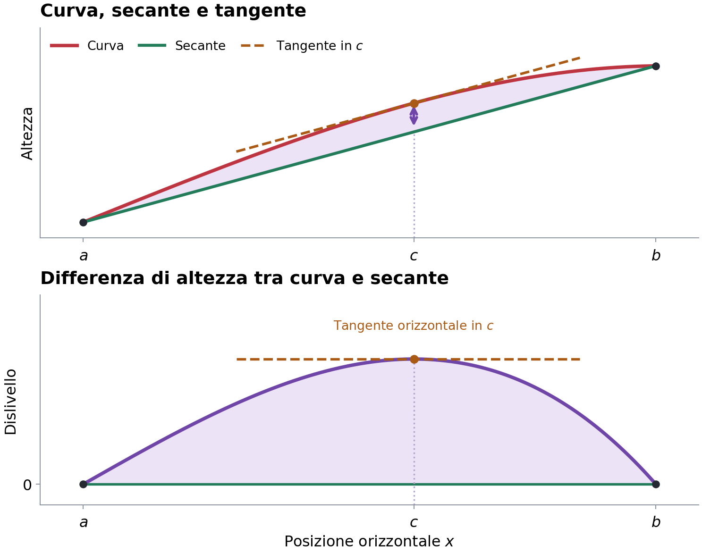
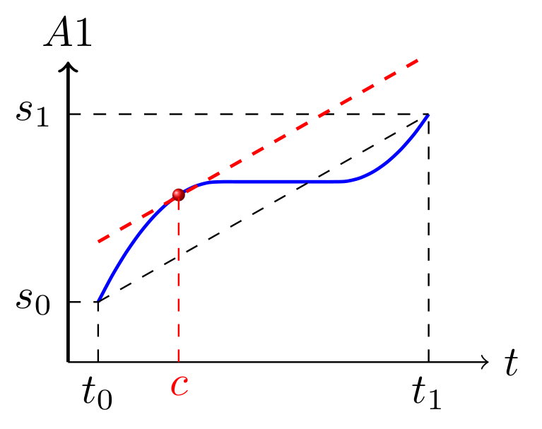
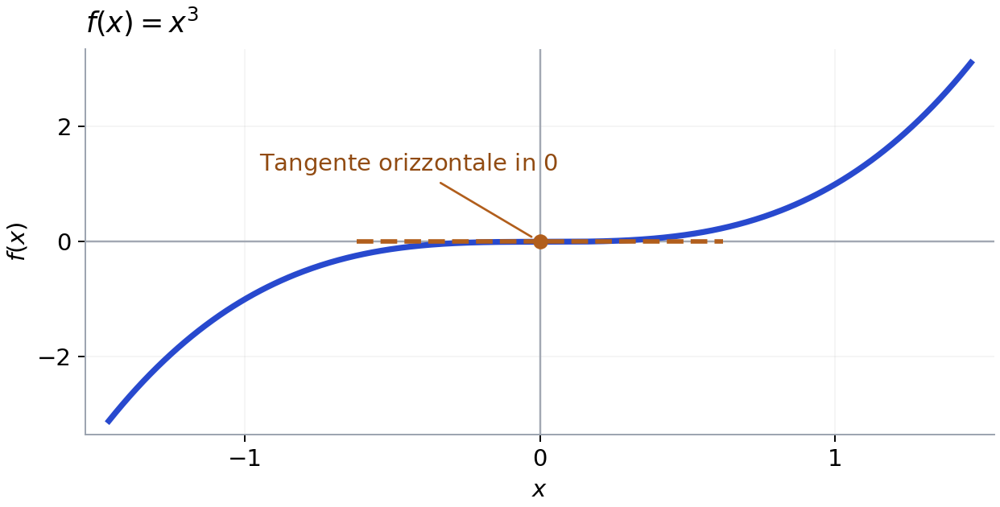
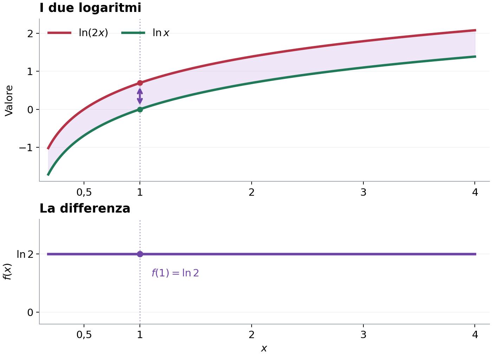
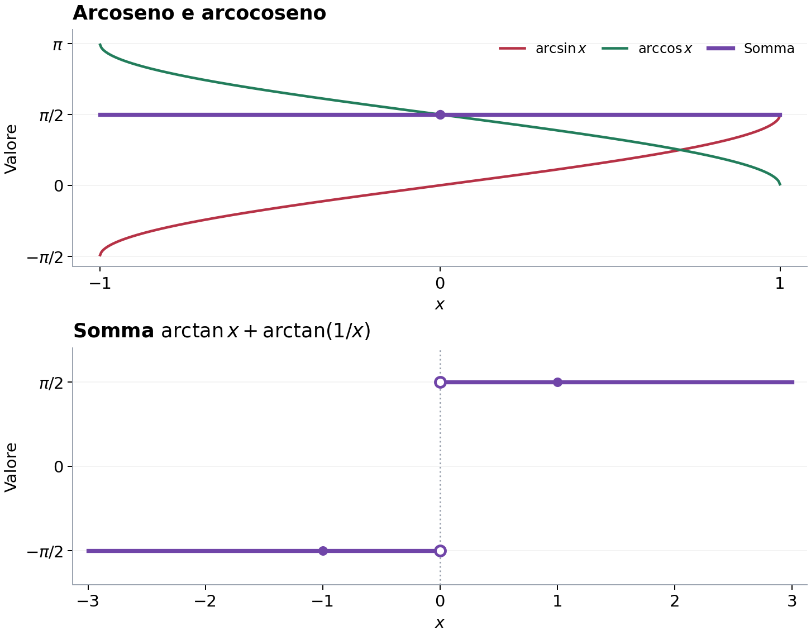
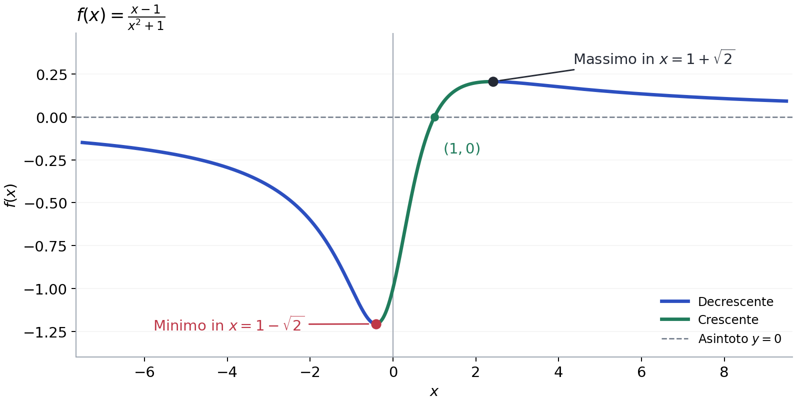
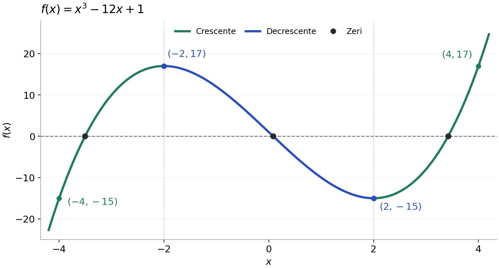
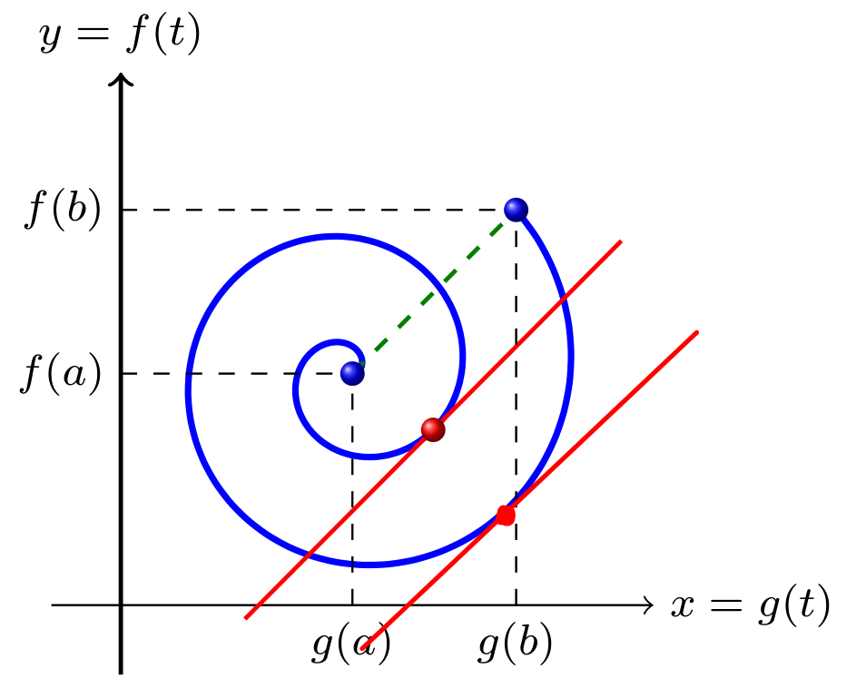

# Derivate

Appunti di **Analisi Matematica 1** — definizioni, proprietà, dimostrazioni essenziali, esempi e formulario delle derivate.

> Materiale organizzato per lo **studio e il ripasso**. I grafici sono schemi esplicativi; la sezione 13 raccoglie le formule di derivazione in una tabella sintetica.

## Indice

1. [Perché nasce la derivata — la retta tangente](#1-perché-nasce-la-derivata--la-retta-tangente)
2. [Definizione di derivata](#2-definizione-di-derivata)
3. [Rapporto incrementale](#3-rapporto-incrementale)
4. [Significato geometrico: dalla secante alla tangente](#4-significato-geometrico-dalla-secante-alla-tangente)
5. [Equazione della retta tangente](#5-equazione-della-retta-tangente)
6. [Riepilogo delle formule](#6-riepilogo-delle-formule)
7. [Retta tangente come migliore approssimante affine](#7-retta-tangente-come-migliore-approssimante-affine)
8. [Primi esempi: derivata di x² e retta tangente](#8-primi-esempi-derivata-di-x²-e-retta-tangente)
9. [Derivabilità e continuità](#9-derivabilità-e-continuità)
10. [Valore assoluto: continua ma non derivabile](#10-valore-assoluto-continua-ma-non-derivabile)
11. [Cuspidi e tangenti verticali](#11-cuspidi-e-tangenti-verticali)
12. [Funzione di Weierstrass: continua ovunque ma mai derivabile](#12-funzione-di-weierstrass-continua-ovunque-ma-mai-derivabile)
13. [Derivate elementari e regole di derivazione — griglia sintetica](#13-derivate-elementari-e-regole-di-derivazione--griglia-sintetica)
14. [Regola del prodotto (Leibniz)](#14-regola-del-prodotto-leibniz)
15. [Regola della catena](#15-regola-della-catena)
16. [Derivate delle funzioni inverse](#16-derivate-delle-funzioni-inverse)
17. [Regola del quoziente](#17-regola-del-quoziente)
18. [Esempio: prodotto con il valore assoluto](#18-esempio-prodotto-con-il-valore-assoluto)
19. [Teorema di Fermat](#19-teorema-di-fermat)
20. [Esempio di ricerca degli estremi](#20-esempio-di-ricerca-degli-estremi)
21. [Teorema di Rolle](#21-teorema-di-rolle)
22. [Teorema di Lagrange](#22-teorema-di-lagrange)
23. [Monotonia e segno della derivata](#23-monotonia-e-segno-della-derivata)
24. [Funzioni costanti su intervalli](#24-funzioni-costanti-su-intervalli)
25. [Studio di una funzione razionale](#25-studio-di-una-funzione-razionale)
26. [Conteggio degli zeri con la monotonia](#26-conteggio-degli-zeri-con-la-monotonia)
27. [Teorema di Cauchy](#27-teorema-di-cauchy)
28. [Regola di de l’Hôpital](#28-regola-di-de-lhôpital)

## 1. Perché nasce la derivata — la retta tangente

Il calcolo differenziale nasce nel XVII secolo (Newton e Leibniz) anche per affrontare un problema geometrico: **determinare la retta tangente a una curva in un punto**.


- **Curva blu:** grafico della funzione $f(x)$.
- **Punto P:** punto in cui cerchiamo la tangente.
- **Retta rossa:** tangente alla curva nel punto P, con la stessa **inclinazione locale**.
- La tangente **può anche attraversare** la curva: non deve necessariamente limitarsi a toccarla.

## 2. Definizione di derivata

Una funzione è **derivabile nel punto $x_0$** se esiste ed è **finito** il limite del rapporto incrementale:

```math
\boxed{f'(x_0)=\lim_{x\to x_0}\frac{f(x)-f(x_0)}{x-x_0}}
```

Nel rapporto:

- $x_0$ è il **punto fissato** in cui vogliamo calcolare la derivata;
- $x$ è un punto che **si avvicina** a $x_0$;
- $f(x)-f(x_0)$ è la **variazione verticale** della funzione;
- $x-x_0$ è la **variazione orizzontale** della variabile indipendente.

Quando ci si avvicina a $x_0$ da entrambi i lati, i **limiti destro e sinistro del rapporto incrementale** devono coincidere e dare un valore finito.

## 3. Rapporto incrementale

Ponendo $h=x-x_0$, quindi $x=x_0+h$, la stessa definizione si scrive:

```math
\boxed{f'(x_0)=\lim_{h\to 0}\frac{f(x_0+h)-f(x_0)}{h}}
```

Il rapporto incrementale, **prima di calcolare il limite**, è:

```math
\boxed{m_h=\frac{f(x_0+h)-f(x_0)}{h}},\qquad h\ne 0.
```

Qui $h$ misura di quanto cambia l'ascissa rispetto a $x_0$.

## 4. Significato geometrico: dalla secante alla tangente

Consideriamo due punti del grafico:

```math
P=(x_0,f(x_0)),\qquad Q=(x_0+h,f(x_0+h)).
```

La **secante** è la retta che passa per P e Q. Il suo coefficiente angolare è il rapporto incrementale:

```math
m_h=\frac{f(x_0+h)-f(x_0)}{h}.
```


- **Blu:** grafico di $f(x)$.
- **Verde:** secante per i due punti P e Q.
- **Rosso:** tangente in P.
- **$h$:** distanza orizzontale orientata da $x_0$ a $x_0+h$.
- **$\Delta f=f(x_0+h)-f(x_0)$:** variazione verticale.

Quando $h\to0$, Q si avvicina a P. **Se il limite del rapporto incrementale esiste ed è finito**, la pendenza della secante tende a quella della tangente:

```math
\boxed{m_{\mathrm{tangente}}=\lim_{h\to0}m_h=f'(x_0)}.
```

**Idea da ricordare:** la derivata è il **coefficiente angolare della retta tangente**.

## 5. Equazione della retta tangente

L'equazione di una retta che passa per $(x_0,y_0)$ con coefficiente angolare $m$ è:

```math
y-y_0=m(x-x_0).
```

Nel nostro caso $y_0=f(x_0)$ e $m=f'(x_0)$, quindi:

```math
\boxed{y=f(x_0)+f'(x_0)(x-x_0)}.
```

Questa è **l'equazione della retta tangente al grafico** di $f$ nel punto di ascissa $x_0$.

## 6. Riepilogo delle formule

| Oggetto | Formula |
| --- | --- |
| Rapporto incrementale | $\displaystyle m_h=\frac{f(x_0+h)-f(x_0)}{h}$ |
| Derivata nel punto $x_0$ | $\displaystyle f'(x_0)=\lim_{h\to0}\frac{f(x_0+h)-f(x_0)}{h}$ |
| Derivata, forma con $x$ | $\displaystyle f'(x_0)=\lim_{x\to x_0}\frac{f(x)-f(x_0)}{x-x_0}$ |
| Pendenza della tangente | $m=f'(x_0)$ |
| Retta tangente | $y=f(x_0)+f'(x_0)(x-x_0)$ |

## 7. Retta tangente come migliore approssimante affine

Una funzione **affine** è una funzione della forma

```math
y=mx+q.
```

Fra tutte le rette che passano per $P_0=(x_0,f(x_0))$, se $f$ è derivabile in $x_0$, **la retta tangente è la migliore approssimante affine della funzione vicino a $x_0$**:

```math
T(x)=f(x_0)+f'(x_0)(x-x_0).
```

Partiamo dalla definizione di derivata:

```math
\lim_{x\to x_0}\frac{f(x)-f(x_0)}{x-x_0}=f'(x_0).
```

Sottrarre il limite $f'(x_0)$ equivale a scrivere

```math
\lim_{x\to x_0}\left[\frac{f(x)-f(x_0)}{x-x_0}-f'(x_0)\right]=0.
```

Mettendo tutto sotto lo stesso denominatore:

```math
\boxed{\lim_{x\to x_0}\frac{f(x)-[f(x_0)+f'(x_0)(x-x_0)]}{x-x_0}=0}.
```

Nel numeratore c'è l'**errore di approssimazione** $f(x)-T(x)$; al denominatore c'è $x-x_0$. Significa che l'errore tende a zero **più rapidamente** di $x-x_0$.

In forma compatta: $f(x)=T(x)+o(x-x_0)$ per $x\to x_0$.

## 8. Primi esempi: derivata di x² e retta tangente

Consideriamo due esercizi sulla funzione $f(x)=x^2$.

### Esercizio 1 — derivata in $x_0=1$

Per definizione:

```math
\begin{aligned}
f'(1)&=\lim_{x\to1}\frac{f(x)-f(1)}{x-1}\\
&=\lim_{x\to1}\frac{x^2-1}{x-1}.
\end{aligned}
```

La sostituzione diretta dà la forma indeterminata $0/0$. Si usa la **differenza di quadrati**, non il raccoglimento di $x$:

```math
x^2-1=(x-1)(x+1).
```

Quindi

```math
\begin{aligned}
f'(1)&=\lim_{x\to1}\frac{(x-1)(x+1)}{x-1}\\
&=\lim_{x\to1}(x+1)=\boxed{2}.
\end{aligned}
```

Dunque la tangente in $x_0=1$ ha **coefficiente angolare $m=f'(1)=2$**.

### Esercizio 2 — equazione della tangente nel punto $(1,1)$

La formula generale è

```math
y=f(x_0)+f'(x_0)(x-x_0).
```

Per $f(x)=x^2$ e $x_0=1$:

- $f(1)=1^2=1$ si trova **sostituendo $x=1$ nella funzione**, senza calcolare alcuna derivata;
- $f'(1)=2$ è la **derivata**, trovata con il limite del rapporto incrementale.

L'equazione richiesta è

```math
\boxed{y=1+2(x-1)}.
```

**Distinzione essenziale:** $f(1)$ è il valore della funzione nel punto, mentre $f'(1)$ è il coefficiente angolare della tangente in quel punto.

---

## 9. Derivabilità e continuità

**Teorema:** se una funzione è derivabile in un punto $x_0$, allora è continua in quel punto:

```math
\boxed{f\text{ derivabile in }x_0\implies f\text{ continua in }x_0.}
```

**Idea della dimostrazione:** se $f$ è derivabile, il rapporto incrementale ha un limite finito $l=f'(x_0)$:

```math
\lim_{x\to x_0}\frac{f(x)-f(x_0)}{x-x_0}=l.
```

Per $x\neq x_0$, possiamo scrivere:

```math
f(x)-f(x_0)=\underbrace{\frac{f(x)-f(x_0)}{x-x_0}}_{\to l}\cdot \underbrace{(x-x_0)}_{\to 0}.
```

Il primo fattore **è tutta la frazione**, non il denominatore da solo. Il secondo fattore tende a zero. Quindi

```math
\lim_{x\to x_0}\big(f(x)-f(x_0)\big)=l\cdot 0=0,
```

ovvero $\lim_{x\to x_0}f(x)=f(x_0)$: è la definizione di continuità.

**Il contrario non è sempre vero:** una funzione può essere continua senza essere derivabile.

## 10. Valore assoluto: continua ma non derivabile

La funzione $f(x)=|x|$ è continua in $0$:

```math
\lim_{x\to0}|x|=0=f(0).
```

Ma nel punto $0$ ha uno **spigolo**. Il rapporto incrementale da sinistra e da destra dà risultati diversi:

```math
\begin{aligned}
f'_-(0)&=\lim_{x\to0^-}\frac{|x|}{x}=-1,\\
f'_+(0)&=\lim_{x\to0^+}\frac{|x|}{x}=+1.
\end{aligned}
```

Poiché i due limiti non coincidono, **non è derivabile in $0$**. Continuità significa assenza di salti; derivabilità richiede che la pendenza sia ben definita.

## 11. Cuspidi e tangenti verticali

Esistono altre due situazioni in cui una funzione può essere continua ma non derivabile:

- **Cuspide:** i rapporti incrementali da sinistra e destra tendono a infiniti di **segno opposto**. Un esempio è $f(x)=\sqrt{|x|}$ nel punto $0$:

```math
\begin{aligned}
\lim_{x\to0^-}\frac{\sqrt{|x|}}{x}&=-\infty,\\
\lim_{x\to0^+}\frac{\sqrt{|x|}}{x}&=+\infty.
\end{aligned}
```

- **Tangente verticale:** i rapporti incrementali tendono allo **stesso infinito**. Un esempio è $f(x)=\sqrt[3]{x}$ nel punto $0$:

```math
\begin{aligned}
\lim_{x\to0^-}\frac{\sqrt[3]{x}}{x}
=\lim_{x\to0^+}\frac{\sqrt[3]{x}}{x}
=+\infty.
\end{aligned}
```

In entrambi i casi la **derivata ordinaria non esiste in $0$**, perché il limite del rapporto incrementale non è finito. Attenzione: anche nella cuspide i due rami hanno direzione verticale, ma le pendenze divergono con segni opposti.

**Distinzione importante:** può capitare che $f(x)\to0$ mentre il **rapporto incrementale** tende a $\pm\infty$. Il primo riguarda l'altezza del grafico, il secondo la sua inclinazione.

## 12. Funzione di Weierstrass: continua ovunque ma mai derivabile

Un caso particolarmente sorprendente è la **funzione di Weierstrass**, definita da

```math
\boxed{f(x)=\sum_{n=0}^{+\infty}a^n\cos(b^n\pi x)}
```

con i parametri scelti in modo che

```math
\begin{aligned}
&a\in(0,1),\qquad b\in\mathbb N\text{ dispari},\\
&ab>1+\frac{3\pi}{2}.
\end{aligned}
```

**Proprietà:** la funzione è **continua in ogni punto**, ma **non è derivabile in alcun punto**.

**Intuizione:** i coseni introducono oscillazioni sempre più rapide (frequenze $b^n$), mentre le loro ampiezze diminuiscono (fattori $a^n$). Il grafico resta continuo, ma presenta irregolarità a ogni scala, senza una pendenza ben definita.

Questo esempio mostra che **la continuità non garantisce la derivabilità, neppure in un singolo punto**.

---

## 13. Derivate elementari e regole di derivazione — griglia sintetica

### Derivate delle funzioni elementari

Le condizioni si riferiscono all'esistenza della derivata. Gli angoli sono espressi in radianti.

| Funzione $f(x)$ | Derivata $f'(x)$ | Condizioni | Funzione $f(x)$ | Derivata $f'(x)$ | Condizioni |
| :--- | :--- | :--- | :--- | :--- | :--- |
| $\alpha$ | $0$ | $\alpha\in\mathbb R,\ x\in\mathbb R$ | $x^\alpha$ | $\alpha x^{\alpha-1}$ | $\alpha\in\mathbb R,\ x>0$ |
| $\sin x$ | $\cos x$ | $x\in\mathbb R$ | $\cos x$ | $-\sin x$ | $x\in\mathbb R$ |
| $e^x$ | $e^x$ | $x\in\mathbb R$ | $\ln\lvert x\rvert$ | $\displaystyle\frac1x$ | $x\ne0$ |
| $a^x$ | $a^x\ln a$ | $a>0,\ x\in\mathbb R$ | $\log_a\lvert x\rvert$ | $\displaystyle\frac1{x\ln a}$ | $a>0,\ a\ne1,\ x\ne0$ |
| $\tan x$ | $1+\tan^2x$ | $\displaystyle x\ne\frac{\pi}{2}+k\pi,\ k\in\mathbb Z$ | $\arctan x$ | $\displaystyle\frac1{1+x^2}$ | $x\in\mathbb R$ |
| $\arcsin x$ | $\displaystyle\frac1{\sqrt{1-x^2}}$ | $-1<x<1$ | $\arccos x$ | $\displaystyle-\frac1{\sqrt{1-x^2}}$ | $-1<x<1$ |
| $\sinh x$ | $\cosh x$ | $x\in\mathbb R$ | $\cosh x$ | $\sinh x$ | $x\in\mathbb R$ |

Per $x^\alpha$ è indicata la condizione generale per un esponente reale. Se $\alpha$ è un intero positivo, la formula vale per ogni $x\in\mathbb R$.

### Regole operative di derivazione
Nelle formule $f$ e $g$ sono funzioni derivabili e $a,b$ sono costanti reali.

| Regola | Formula |
| :--- | :--- |
| Moltiplicazione per una costante | $\displaystyle (a f(x))'=a f'(x)$ |
| Somma | $\displaystyle (f(x)+g(x))'=f'(x)+g'(x)$ |
| Differenza | $\displaystyle (f(x)-g(x))'=f'(x)-g'(x)$ |
| Linearità (forma generale) | $\displaystyle (a f(x)+b g(x))'=a f'(x)+b g'(x)$ |
| Prodotto (Leibniz) | $\displaystyle (f(x)g(x))'=f'(x)g(x)+f(x)g'(x)$ |
| Quoziente | $\displaystyle \left(\frac{f(x)}{g(x)}\right)'=\frac{f'(x)g(x)-f(x)g'(x)}{[g(x)]^2}$ |
| Funzione composta (catena) | $\displaystyle (f(g(x)))'=f'(g(x))\,g'(x)$ |

**Notazione:** $\displaystyle f'(x)=D[f(x)]=\frac{d}{dx}f(x)$.

## 14. Regola del prodotto (Leibniz)

Se $f(x)$ e $g(x)$ sono derivabili, anche il loro prodotto è derivabile e vale:

```math
\boxed{\big(f(x)g(x)\big)'=f'(x)g(x)+f(x)g'(x)}
```

**Come si applica:** si sommano due termini: la derivata della prima funzione per la seconda invariata, e la prima invariata per la derivata della seconda.

**Errore da evitare:** in generale $\big(fg\big)'\ne f'g'$.

**Esempio di riconoscimento:** nel prodotto $x^2\sin x$, le due funzioni sono

```math
f(x)=x^2,\qquad g(x)=\sin x.
```

Le derivate da utilizzare sono $(x^2)'=2x$ e $(\sin x)'=\cos x$.

## 15. Regola della catena

Serve per le **funzioni composte**: una funzione $f$ applicata al risultato di un'altra funzione $g$.

Se $g$ è derivabile in $x$ e $f$ è derivabile in $g(x)$, allora:

```math
\boxed{\big(f(g(x))\big)'=f'(g(x))\cdot g'(x)}
```

**Come si applica:** si deriva la funzione esterna, lasciando invariata l'espressione interna, e poi si moltiplica per la derivata della funzione interna.

**Esempio di riconoscimento:** in $\sin(x^2)$,

- la **funzione esterna** è $f(y)=\sin y$;
- la **funzione interna** è $g(x)=x^2$.

Le derivate da utilizzare sono $(\sin y)'=\cos y$ e $(x^2)'=2x$.

**Attenzione ai segni:** $(\sin x)'=\cos x$, mentre $(\cos x)'=-\sin x$.

## 16. Derivate delle funzioni inverse

Se $f$ è invertibile, derivabile in $x_0$ e $f'(x_0)\ne 0$, la derivata della sua inversa nel punto $y_0=f(x_0)$ è:

```math
\boxed{(f^{-1})'(y_0)=\frac{1}{f'(x_0)}}
```

**Attenzione:** $f^{-1}$ indica la funzione inversa, non il reciproco $1/f$.

### Derivata dell'arcoseno

L'arcoseno è l'inversa del seno ristretto all'intervallo $[-\pi/2,\pi/2]$.

| Funzione inversa | Derivata | Validità |
| :--- | :--- | :--- |
| $\arcsin x$ | $\displaystyle \boxed{(\arcsin x)'=\frac{1}{\sqrt{1-x^2}}}$ | $-1<x<1$ |

La radice deriva dall'identità trigonometrica $\sin^2 y+\cos^2 y=1$: nell'intervallo scelto, $\cos y\ge 0$, quindi $\cos y=\sqrt{1-\sin^2 y}$.

## 17. Regola del quoziente

Siano $f$ e $g$ derivabili nel punto $x$, con $g(x)\ne0$. Allora anche il loro quoziente è derivabile in quel punto e vale:

```math
\boxed{\left(\frac{f(x)}{g(x)}\right)'=\frac{f'(x)g(x)-f(x)g'(x)}{[g(x)]^2}}
```

**Come si applica:** al numeratore si scrive la derivata del numeratore per il denominatore, meno il numeratore per la derivata del denominatore. Al denominatore si mette il quadrato del denominatore originale.

## 18. Esempio: prodotto con il valore assoluto

Studiamo continuità e derivabilità della funzione

```math
f(x)=x|x|,\qquad x\in\mathbb R.
```

### Continuità e derivabilità fuori dall'origine

Le funzioni $x$ e $|x|$ sono entrambe continue su $\mathbb R$, quindi anche il loro prodotto è continuo su $\mathbb R$.

Per $x\ne0$, entrambi i fattori sono derivabili, quindi anche $f$ è derivabile. In $0$, invece, $|x|$ non è derivabile: **non possiamo applicare la regola del prodotto**, ma questo non basta per concludere che $x|x|$ non sia derivabile. Studiamo direttamente il rapporto incrementale.

### Derivabilità nell'origine

Separando i casi secondo il segno di $x$, otteniamo:

```math
f(x)=
\begin{cases}
x^2,&x\ge0,\\
-x^2,&x<0,
\end{cases}
\qquad f(0)=0.
```

Da destra, $h>0$, quindi $f(h)=h^2$:

```math
f'_+(0)=\lim_{h\to0^+}\frac{f(h)-f(0)}h
=\lim_{h\to0^+}\frac{h^2}{h}
=\lim_{h\to0^+}h=0.
```

Da sinistra, $h<0$, quindi $f(h)=-h^2$:

```math
f'_-(0)=\lim_{h\to0^-}\frac{f(h)-f(0)}h
=\lim_{h\to0^-}\frac{-h^2}{h}
=\lim_{h\to0^-}(-h)=0.
```

**I due limiti laterali coincidono e sono finiti**, dunque il limite complessivo del rapporto incrementale esiste ed è finito. Per definizione, questo significa che $f$ è derivabile in $0$ e

```math
\boxed{f'(0)=0}.
```

La funzione $x|x|$ è quindi derivabile su tutto $\mathbb R$, anche se il singolo fattore $|x|$ non è derivabile in $0$.

### Il collegamento con la definizione di derivata

La derivata in $0$ è definita come

```math
f'(0)=\lim_{h\to0}\frac{f(h)-f(0)}h,
```

purché il limite esista e sia finito. Per avere un unico limite finito $L$, il rapporto incrementale deve tendere allo stesso numero $L$ sia da sinistra sia da destra. Ecco perché l'uguaglianza dei due limiti laterali finiti permette di concludere che la derivata esiste.

### Distinzione fra le due funzioni e i loro rapporti incrementali

| Funzione | Rapporto incrementale in $0$, per $h\ne0$ | Comportamento per $h\to0$ |
| :--- | :--- | :--- |
| $f(x)=x\lvert x\rvert$ | $\displaystyle\frac{h\lvert h\rvert-0}{h}=\lvert h\rvert$ | Tende a $0$ da entrambi i lati |
| $u(x)=\lvert x\rvert$ | $\displaystyle\frac{\lvert h\rvert-0}{h}=\frac{\lvert h\rvert}{h}$ | Vale $1$ a destra e $-1$ a sinistra: il limite non esiste |

Infatti, per il solo valore assoluto:

```math
\frac{|h|}{h}=
\begin{cases}
\frac{h}{h}=1,&h>0,\\[4pt]
\frac{-h}{h}=-1,&h<0.
\end{cases}
```

Il limite della funzione $|x|$ in $0$ vale $0$, quindi $|x|$ è continua in $0$. Il limite del suo rapporto incrementale, invece, non esiste: **continuità e derivabilità riguardano due limiti diversi**.

## 19. Teorema di Fermat

Sia $f:(a,b)\to\mathbb R$ e sia $x_0\in(a,b)$. Supponiamo che:

- $x_0$ sia un punto di **massimo o minimo relativo** per $f$;
- $f$ sia **derivabile in $x_0$**.

Allora:

```math
\boxed{f'(x_0)=0}.
```

Il punto $x_0$ deve essere **interno**: deve essere possibile avvicinarsi a esso sia da sinistra sia da destra restando nel dominio. La derivabilità richiede che i due limiti del rapporto incrementale coincidano e siano finiti.

**Significato geometrico:** in un estremo relativo interno in cui $f$ è derivabile, la retta tangente è orizzontale. La sua equazione è:

```math
y=f(x_0).
```

**Come si usa:** se $f$ è derivabile su un intervallo, per cercare i suoi massimi e minimi relativi interni si risolve:

```math
f'(x)=0.
```

Le soluzioni sono **candidati**: la condizione $f'(x_0)=0$ è necessaria nelle ipotesi del teorema, ma **non è sufficiente** per concludere che $x_0$ sia un massimo o un minimo relativo. Occorre verificarlo separatamente.

Il teorema non si applica ai punti estremi del dominio né ai punti in cui $f$ non è derivabile.

## 20. Esempio di ricerca degli estremi

Per $f(x)=x\sqrt{x^2+1}$, il radicando soddisfa $x^2+1\ge1$, quindi $f$ è derivabile su $\mathbb R$. Le regole del prodotto e della catena danno

```math
f'(x)=\sqrt{x^2+1}+\frac{x^2}{\sqrt{x^2+1}}
=\frac{2x^2+1}{\sqrt{x^2+1}}>0.
```

**Su $\mathbb R$**, il teorema di Fermat esclude massimi e minimi relativi, perché $f'$ è sempre positiva. Questo esclude anche gli estremi assoluti, che sarebbero anche relativi.

**Su $[1,2]$**, entrambi i fattori $x$ e $\sqrt{x^2+1}$ sono positivi e strettamente crescenti. Il prodotto è quindi strettamente crescente e vale $f(1)\le f(x)\le f(2)$ per ogni $x\in[1,2]$.

| Estremo assoluto su $[1,2]$ | Punto | Valore |
| :--- | :--- | :--- |
| Minimo | $x=1$ | $f(1)=\sqrt{2}$ |
| Massimo | $x=2$ | $f(2)=2\sqrt{5}$ |

I due punti sono ai bordi del dominio ristretto. Il teorema di Fermat richiede un punto interno.

## 21. Teorema di Rolle

Sia $f:[a,b]\to\mathbb R$ continua su $[a,b]$ e derivabile su $(a,b)$, con $a<b$. Se $f(a)=f(b)$, allora

```math
\boxed{\exists\,c\in(a,b)\quad\text{tale che}\quad f'(c)=0}.
```

La condizione $f'(c)=0$ corrisponde a una tangente orizzontale nel punto $(c,f(c))$.

### Dimostrazione

**Annotazione sul teorema di Weierstrass.** Una funzione continua su un intervallo chiuso e limitato $[a,b]$ raggiunge il minimo e il massimo assoluti.

```math
\exists\,x_m,x_M\in[a,b]\quad\text{tali che}\quad
f(x_m)\le f(x)\le f(x_M)\qquad\forall x\in[a,b].
```

I valori raggiunti in questi punti sono

```math
m=f(x_m)=\min_{x\in[a,b]}f(x),
\qquad
M=f(x_M)=\max_{x\in[a,b]}f(x).
```

1. **Se $f(a)<M$**, anche $f(b)=f(a)<M$. Il punto $x_M$ in cui $f(x_M)=M$ è quindi interno. Poiché è un massimo relativo e $f$ è derivabile in $x_M$, per Fermat $f'(x_M)=0$. Si può scegliere $c=x_M$.

2. **Se $f(a)=M$ e $m=M$**, per ogni $x\in[a,b]$ vale $M=m\le f(x)\le M$. Dunque $f(x)=M$ su tutto l'intervallo. La funzione è costante e $f'(c)=0$ in ogni punto $c\in(a,b)$.

3. **Se $f(a)=M$ e $m<M$**, si ha $f(a)=f(b)=M>m$. Il punto $x_m$ in cui $f(x_m)=m$ è quindi interno. Poiché è un minimo relativo e $f$ è derivabile in $x_m$, per Fermat $f'(x_m)=0$. Si può scegliere $c=x_m$.

## 22. Teorema di Lagrange

Sia $f:[a,b]\to\mathbb R$ continua su $[a,b]$ e derivabile su $(a,b)$, con $a<b$. Esiste almeno un $c\in(a,b)$ tale che

```math
\boxed{f'(c)=\frac{f(b)-f(a)}{b-a}}.
```

La tangente alla curva in $(c,f(c))$ ha la stessa pendenza della secante che unisce $(a,f(a))$ e $(b,f(b))$.



Nel grafico in alto la freccia viola misura il dislivello fra la curva rossa e la secante verde **alla stessa ascissa**. Il grafico in basso riporta quel dislivello per ogni $x$.

### La secante e il dislivello

Indichiamo con $m$ la pendenza della secante e con $g(x)$ la sua altezza all'ascissa $x$.

```math
m=\frac{f(b)-f(a)}{b-a},
\qquad
g(x)=f(a)+m(x-a).
```

All'ascissa $a$ lo spostamento $x-a$ vale zero. All'ascissa $b$ il prodotto $m(b-a)$ è il dislivello $f(b)-f(a)$.

```math
\begin{aligned}
g(a)&=f(a)+m(a-a)=f(a),\\
g(b)&=f(a)+m(b-a)=f(a)+f(b)-f(a)=f(b).
\end{aligned}
```

La curva e la retta hanno quindi la stessa altezza agli estremi. La funzione dislivello $h$ vale zero in entrambi.

```math
h(x)=f(x)-g(x),\qquad
h(a)=f(a)-g(a)=0,\qquad
h(b)=f(b)-g(b)=0.
```

### Dalle altezze alle pendenze

Spostiamo la freccia da $x_1$ a $x_2$, con passo orizzontale $\Delta x=x_2-x_1>0$. Le due punte si spostano orizzontalmente dello stesso passo. Se la punta sulla curva sale di $3$ e quella sulla secante di $2$, la freccia si allunga di $3-2=1$.

```math
\begin{aligned}
\Delta h
&=h(x_2)-h(x_1)\\
&=[f(x_2)-f(x_1)]-[g(x_2)-g(x_1)]\\
&=\Delta f-\Delta g.
\end{aligned}
```

Per ottenere le pendenze sul tratto, dividiamo tutte le variazioni in altezza per lo stesso passo.

```math
\frac{\Delta h}{\Delta x}
=\frac{\Delta f}{\Delta x}-\frac{\Delta g}{\Delta x}.
```

Facendo tendere il passo a zero in un punto interno, si ottiene la relazione tra le pendenze delle tangenti.

```math
h'(x)=f'(x)-g'(x).
```

### Applicazione di Rolle

La secante $g$ è una funzione affine. In base alle ipotesi su $f$, la differenza $h=f-g$ è continua su $[a,b]$ e derivabile su $(a,b)$. Poiché $h(a)=h(b)=0$, per Rolle esiste un punto $c\in(a,b)$ con $h'(c)=0$. Nel grafico in basso la tangente al dislivello in $c$ è orizzontale.

La secante ha pendenza costante $g'(x)=m$. Nel punto $c$ si ha

```math
0=h'(c)=f'(c)-g'(c)=f'(c)-m
\quad\Longrightarrow\quad
f'(c)=m=\frac{f(b)-f(a)}{b-a}.
```

Nel grafico in alto la tangente arancione e la secante verde sono quindi parallele. Se $f(a)=f(b)$, si ha $m=0$ e si ritrova la conclusione di Rolle.

### Esempio del Tutor

Nel grafico, $t$ è il tempo e $s(t)$ è la posizione dell'auto lungo il percorso. I due rilevamenti sono $(t_0,s_0)$ e $(t_1,s_1)$.



La pendenza della secante nera è la velocità media sull'intero tratto.

```math
v_{\mathrm{media}}=\frac{s_1-s_0}{t_1-t_0}.
```

La pendenza della tangente rossa in $c$ è la velocità istantanea. Si ottiene dalla velocità media fra $c$ e $c+Delta t$, facendo tendere a zero il passo temporale $Delta t$.

```math
v(c)=s'(c)=\lim_{\Delta t\to0}\frac{s(c+\Delta t)-s(c)}{\Delta t}.
```

Se $s$ è continua su $[t_0,t_1]$ e derivabile su $(t_0,t_1)$, Lagrange garantisce un istante $c\in(t_0,t_1)$ in cui le due pendenze coincidono.

```math
v(c)=v_{\mathrm{media}}.
```

Per esempio, con una media di $120\,\mathrm{km/h}$ esiste un istante in cui la velocità è $120\,\mathrm{km/h}$. Se il limite è costante lungo il tratto e la media lo supera, la velocità in quell'istante supera lo stesso limite.

## 23. Monotonia e segno della derivata

Sia $f:(a,b)\to\mathbb R$ derivabile. Le due condizioni di ogni riga sono equivalenti. Qui crescente e decrescente sono intesi in senso non stretto.

| Segno della derivata su $(a,b)$ | Monotonia su $(a,b)$ |
| :--- | :--- |
| $f'(x)\ge0$ per ogni $x$ | Crescente. Per ogni $x_1<x_2$ vale $f(x_1)\le f(x_2)$. |
| $f'(x)\le0$ per ogni $x$ | Decrescente. Per ogni $x_1<x_2$ vale $f(x_1)\ge f(x_2)$. |

### Dal segno della derivata alla monotonia

Scegliamo $a<x_1<x_2<b$. La derivabilità di $f$ garantisce la continuità su $[x_1,x_2]$. Per Lagrange esiste $c\in(x_1,x_2)$ tale che

```math
f'(c)=\frac{f(x_2)-f(x_1)}{x_2-x_1}
\quad\Longrightarrow\quad
f(x_2)-f(x_1)=f'(c)(x_2-x_1).
```

Poiché $x_2-x_1>0$, la variazione $f(x_2)-f(x_1)$ ha lo stesso segno di $f'(c)$. Se $f'\ge0$ in tutto l'intervallo, otteniamo $f(x_2)\ge f(x_1)$. Se $f'\le0$, otteniamo $f(x_2)\le f(x_1)$.

### Dalla monotonia al segno della derivata

Fissiamo $x\in(a,b)$ e prendiamo un passo verso destra $\Delta x>0$ con $x+\Delta x\in(a,b)$. Se $f$ è crescente, $f(x+\Delta x)-f(x)\ge0$, quindi

```math
\frac{f(x+\Delta x)-f(x)}{\Delta x}\ge0.
```

Facendo tendere $\Delta x$ a zero da destra, il rapporto tende a $f'(x)$ perché $f$ è derivabile in $x$. Si ottiene $f'(x)\ge0$. Per una funzione decrescente il numeratore è $\le0$, quindi il limite dà $f'(x)\le0$.

### Monotonia stretta e tangente orizzontale

Nella formula di Lagrange, $f'(x)>0$ in ogni punto dell'intervallo implica $f(x_2)>f(x_1)$ per ogni $x_2>x_1$. La funzione è strettamente crescente. Analogamente, $f'(x)<0$ in ogni punto implica decrescenza stretta.

La cubica $f(x)=x^3$ è strettamente crescente su $\mathbb R$ e ha $f'(0)=0$. Infatti $f'(x)=3x^2>0$ sui due intervalli $(-\infty,0)$ e $(0,+\infty)$. I valori a sinistra di $0$ sono negativi e quelli a destra sono positivi, con $f(0)=0$.

Partendo da $0$, ogni passo $\Delta x>0$ porta a un'altezza maggiore di $f(0)$. La pendenza sul passo è positiva e tende a zero quando il passo si accorcia.

```math
\begin{aligned}
f(\Delta x)-f(0)&=(\Delta x)^3>0,\\
\frac{f(\Delta x)-f(0)}{\Delta x}&=(\Delta x)^2\longrightarrow0
\qquad(\Delta x\to0^+).
\end{aligned}
```



## 24. Funzioni costanti su intervalli

Sia $f$ derivabile su un intervallo $I=(a,b)$. Il criterio è

```math
\boxed{f\text{ costante su }I
\quad\Longleftrightarrow\quad
f'(x)=0\ \text{per ogni }x\in I.}
```

Se $f(x)=k$ su $I$, il rapporto incrementale è $(k-k)/\Delta x=0$ per ogni passo ammesso. Il suo limite dà $f'(x)=0$.

Se $f'(x)=0$ su $I$, valgono sia $f'\ge0$ sia $f'\le0$. Per il criterio di monotonia, per ogni $x_1<x_2$ in $I$ si ottengono entrambe le disuguaglianze

```math
f(x_1)\le f(x_2),\qquad f(x_1)\ge f(x_2)
\quad\Longrightarrow\quad f(x_1)=f(x_2).
```

Per trovare il valore costante si sceglie un punto comodo $x_0\in I$ e si calcola $f(x_0)$. Allora $f(x)=f(x_0)$ per ogni $x\in I$.

### Differenza di due logaritmi

Per $f(x)=\ln(2x)-\ln x$ con $x>0$, la catena dà

```math
f'(x)=\frac{1}{2x}\cdot 2-\frac1x
=\frac1x-\frac1x=0.
```

Calcoliamo il valore in $x=1$.

```math
f(1)=\ln(2\cdot1)-\ln1=\ln2-0=\ln2,
\qquad f(x)=\ln2\quad(x>0).
```

In alto la freccia mostra la differenza di altezza dei logaritmi alla stessa ascissa. In basso è riportata quella differenza per ogni $x$.



### Somma di arcoseno e arcocoseno

Per $f(x)=\arcsin x+\arccos x$ su $(-1,1)$, le due derivate si cancellano.

```math
f'(x)=\frac{1}{\sqrt{1-x^2}}-\frac{1}{\sqrt{1-x^2}}=0.
```

Poiché $\sin 0=0$ e $\cos(\pi/2)=0$, la valutazione in $x=0$ dà il valore comune.

```math
f(x)=f(0)=\arcsin0+\arccos0
=0+\frac{\pi}{2}=\frac{\pi}{2}
\qquad(-1<x<1).
```

Per esempio, il risultato permette di calcolare $\arcsin(0{,}4)+\arccos(0{,}4)=\pi/2$ usando il valore in $0$.

### Somma di arcotangenti su due intervalli

La funzione $f(x)=\arctan x+\arctan(1/x)$ è definita per $x\ne0$. Con la regola della catena e $(1/x)'=-1/x^2$ otteniamo

```math
\begin{aligned}
f'(x)&=\frac1{1+x^2}
+\frac1{1+1/x^2}\left(-\frac1{x^2}\right)\\
&=\frac1{1+x^2}
+\frac{x^2}{x^2+1}\left(-\frac1{x^2}\right)\\
&=\frac1{1+x^2}-\frac1{1+x^2}=0.
\end{aligned}
```

Il criterio si applica separatamente a $(-\infty,0)$ e $(0,+\infty)$. Per ciascun intervallo scegliamo un punto in cui $\arctan(\pm1)=\pm\pi/4$.

```math
\begin{aligned}
f(-1)&=-\frac{\pi}{4}-\frac{\pi}{4}=-\frac{\pi}{2},\\
f(1)&=\frac{\pi}{4}+\frac{\pi}{4}=\frac{\pi}{2}.
\end{aligned}
\qquad
f(x)=\begin{cases}
-\dfrac{\pi}{2},&x<0,\\[4pt]
\dfrac{\pi}{2},&x>0.
\end{cases}
```

Nel pannello in alto la viola è la somma delle ordinate rossa e verde alla stessa $x$. In basso è rappresentata la somma delle arcotangenti, con un'altezza costante per ciascuno dei due intervalli.



### Applicazione al distacco tra due auto

Siano $s_1(t)$ e $s_2(t)$ le posizioni di due auto lungo lo stesso percorso orientato. Se le loro velocità coincidono a ogni istante di un intervallo, il distacco $d(t)=s_2(t)-s_1(t)$ ha derivata

```math
d'(t)=s_2'(t)-s_1'(t)=v_2(t)-v_1(t)=0.
```

Il distacco è quindi costante. Se inizialmente vale $30\,\mathrm{m}$, vale $30\,\mathrm{m}$ per tutto l'intervallo, anche se la velocità comune cambia nel tempo.

## 25. Studio di una funzione razionale

```math
f(x)=\frac{x-1}{x^2+1}.
```

Il denominatore è sempre positivo perché $x^2+1\ge1$. La funzione è definita e derivabile su tutto $\mathbb R$.

### Limiti e intersezioni con gli assi

Dividendo numeratore e denominatore per $x^2$ si ottiene

```math
\frac{x-1}{x^2+1}
=\frac{1/x-1/x^2}{1+1/x^2}
\longrightarrow 0
\qquad(x\to\pm\infty).
```

I limiti indicano come disegnare i rami lontani del grafico. In questo caso entrambi si avvicinano all'asintoto orizzontale $y=0$. Il segno di $f$ coincide con quello di $x-1$, quindi il ramo sinistro si avvicina da sotto e quello destro da sopra.

Le intersezioni con gli assi sono $(0,-1)$ e $(1,0)$, perché $f(0)=-1$ e $f(x)=0$ equivale a $x-1=0$.

### Monotonia ed estremi relativi

Con la regola del quoziente, usando $(x-1)'=1$ e $(x^2+1)'=2x$, si ottiene

```math
\begin{aligned}
f'(x)
&=\frac{1\cdot(x^2+1)-(x-1)\cdot2x}{(x^2+1)^2}\\
&=\frac{x^2+1-2x^2+2x}{(x^2+1)^2}\\
&=\frac{-x^2+2x+1}{(x^2+1)^2}
=\frac{2-(x-1)^2}{(x^2+1)^2}.
\end{aligned}
```

Il denominatore è positivo. Il numeratore è nullo per $(x-1)^2=2$, quindi i punti critici sono $c_-=1-\sqrt2$ e $c_+=1+\sqrt2$. Per $-\sqrt2<x-1<\sqrt2$, il quadrato $(x-1)^2$ è minore di $2$ e $f'$ è positiva. Fuori dai due punti critici e dall'intervallo fra loro è negativa.

| Intervallo | Segno di $f'$ | Andamento di $f$ |
| :--- | :---: | :--- |
| $(-\infty,c_-)$ | $-$ | Decrescente |
| $(c_-,c_+)$ | $+$ | Crescente |
| $(c_+,+\infty)$ | $-$ | Decrescente |

In $c_-$ la funzione passa da decrescente a crescente, quindi ha un minimo relativo. In $c_+$ passa da crescente a decrescente, quindi ha un massimo relativo.

Le ordinate si calcolano nella funzione $f$. I denominatori valgono $(1\pm\sqrt2)^2+1=4\pm2\sqrt2$. Razionalizzando con i coniugati si ricava

```math
\begin{aligned}
f(c_-)&=\frac{-\sqrt2}{4-2\sqrt2}
=\frac{-\sqrt2(2+\sqrt2)}{2(4-2)}
=-\frac{1+\sqrt2}{2},\\[4pt]
f(c_+)&=\frac{\sqrt2}{4+2\sqrt2}
=\frac{\sqrt2(2-\sqrt2)}{2(4-2)}
=\frac{\sqrt2-1}{2}.
\end{aligned}
```



## 26. Conteggio degli zeri con la monotonia

Per contare le soluzioni reali di $x^3=12x-1$, portiamo tutti i termini a sinistra e cerchiamo gli zeri di $f(x)=x^3-12x+1$.

Il polinomio è continuo e derivabile su $\mathbb R$. Raccogliendo $x^3$ si vede che la parentesi tende a $1$ a entrambi gli infiniti.

```math
f(x)=x^3\left(1-\frac{12}{x^2}+\frac{1}{x^3}\right)
\qquad(x\ne0).
```

Quindi $f(x)\to-\infty$ per $x\to-\infty$ e $f(x)\to+\infty$ per $x\to+\infty$. La continuità garantisce almeno uno zero.

Per contare gli zeri, studiamo il segno della derivata.

```math
f'(x)=3x^2-12=3(x^2-4)=3(x-2)(x+2).
```

La derivata è nulla in $x=-2$ e $x=2$. È positiva all'esterno di questi punti e negativa fra i due. Calcoliamo alcuni valori della funzione.

```math
\begin{aligned}
f(-4)&=-64+48+1=-15,\\
f(-2)&=-8+24+1=17,\\
f(2)&=8-24+1=-15,\\
f(4)&=64-48+1=17.
\end{aligned}
```

Il teorema degli zeri garantisce almeno uno zero fra due punti con valori di segno opposto. La monotonia stretta garantisce al massimo uno zero nell'intervallo, perché due ascisse distinte danno valori distinti.

| Intervallo di monotonia | Andamento di $f$ | Valori di segno opposto | Dove cade lo zero |
| :--- | :--- | :--- | :--- |
| $(-\infty,-2)$ | Crescente | $f(-4)<0<f(-2)$ | $(-4,-2)$ |
| $(-2,2)$ | Decrescente | $f(-2)>0>f(2)$ | $(-2,2)$ |
| $(2,+\infty)$ | Crescente | $f(2)<0<f(4)$ | $(2,4)$ |

Poiché $f(-2)=17$ e $f(2)=-15$, i due punti critici sono esclusi dal conteggio. L'equazione ha **esattamente tre soluzioni reali**, una per ciascun intervallo di monotonia.



## 27. Teorema di Cauchy

Siano $a<b$ e $f,g:[a,b]\to\mathbb R$ continue su $[a,b]$ e derivabili su $(a,b)$. Esiste almeno un $c\in(a,b)$ per cui

```math
\boxed{[f(b)-f(a)]\,g'(c)=[g(b)-g(a)]\,f'(c)}.
```

### Dimostrazione

Poniamo $A=f(b)-f(a)$ e $B=g(b)-g(a)$. Consideriamo la funzione $h(t)=A\,g(t)-B\,f(t)$, che è continua su $[a,b]$ e derivabile su $(a,b)$.

```math
\begin{aligned}
h(b)-h(a)
&=A[g(b)-g(a)]-B[f(b)-f(a)]\\
&=AB-BA=0.
\end{aligned}
```

Quindi $h(a)=h(b)$. Per Rolle esiste $c\in(a,b)$ tale che

```math
0=h'(c)=A\,g'(c)-B\,f'(c).
```

Portando $B\,f'(c)$ a destra e sostituendo $A$ e $B$ si ottiene la formula di Cauchy.

### Forma in frazioni e significato geometrico

Se $g'(t)\ne0$ per ogni $t\in(a,b)$, allora $g(b)-g(a)\ne0$. Infatti, l'uguaglianza $g(a)=g(b)$ permetterebbe di applicare Rolle a $g$ e darebbe un punto interno con derivata nulla. Possiamo quindi dividere per $[g(b)-g(a)]g'(c)$.

```math
\boxed{\frac{f(b)-f(a)}{g(b)-g(a)}
=\frac{f'(c)}{g'(c)}}.
```

Nel disegno ogni valore del parametro $t$ individua il punto $(g(t),f(t))$. L'ascissa è $g(t)$ e l'ordinata è $f(t)$. Il rapporto a sinistra è la pendenza della secante verde tra i due estremi.

Per la tangente, consideriamo lo stesso piccolo passo $\Delta t$ nelle due coordinate. Dividendo sia la variazione verticale sia quella orizzontale per $\Delta t$, si vede da dove viene il rapporto a destra.

```math
\frac{f(c+\Delta t)-f(c)}{g(c+\Delta t)-g(c)}
=
\frac{[f(c+\Delta t)-f(c)]/\Delta t}{[g(c+\Delta t)-g(c)]/\Delta t}
\longrightarrow\frac{f'(c)}{g'(c)}
\qquad(\Delta t\to0).
```

Le tangenti rosse illustrano il parallelismo con la secante.



Con $g(t)=t$ si ha $g(b)-g(a)=b-a$ e $g'(c)=1$. La formula restituisce il teorema di Lagrange.

### Applicazione a un limite nella forma 0/0

Se $f(a)=g(a)=0$ e valgono le ipotesi della forma in frazioni su $[a,x]$, Cauchy dà $f(x)/g(x)=f'(c)/g'(c)$ per un $c$ tra $a$ e $x$. Quando $x\to a^+$ anche $c\to a$. Questo passaggio è alla base della regola di de l'Hôpital.

Per esempio, consideriamo $\displaystyle\lim_{x\to0^+}\frac{\sin x}{e^{2x}-1}$. La sostituzione in $0$ dà la forma $0/0$. Poniamo $f(t)=\sin t$ e $g(t)=e^{2t}-1$. Entrambe sono continue e derivabili su $\mathbb R$ e valgono $0$ in $t=0$.

```math
f'(t)=\cos t,\qquad
g'(t)=e^{2t}\cdot 2=2e^{2t}>0.
```

Per ogni $x>0$, Cauchy su $[0,x]$ dà un $c\in(0,x)$ tale che

```math
\frac{\sin x}{e^{2x}-1}
=\frac{f(x)-f(0)}{g(x)-g(0)}
=\frac{\cos c}{2e^{2c}}.
```

Da $0<c<x$ segue $c\to0$ quando $x\to0^+$. Il denominatore a destra tende a $2$, quindi

```math
\boxed{\lim_{x\to0^+}\frac{\sin x}{e^{2x}-1}
=\frac{\cos0}{2e^0}=\frac12}.
```

## 28. Regola di de l’Hôpital

Siano $f$ e $g$ derivabili su $(a,b)$, con $g'(x)\ne0$ per ogni $x\in(a,b)$. Gli estremi dell'intervallo possono essere infiniti. Se per $x\to a^+$ i due termini tendono entrambi a $0$ oppure hanno entrambi limite infinito, e se $f'/g'$ tende a un valore $L$ finito o infinito, allora

```math
\boxed{\lim_{x\to a^+}\frac{f(x)}{g(x)}
=\lim_{x\to a^+}\frac{f'(x)}{g'(x)}=L}.
```

Lo stesso vale per $x\to b^-$. Per applicare la regola si controllano la forma indeterminata e la derivata del denominatore, poi si derivano separatamente numeratore e denominatore.

### Dimostrazione per il caso 0/0 con estremo finito

Supponiamo che $a$ sia finito e che $f(x)$ e $g(x)$ tendano a $0$ per $x\to a^+$. Estendiamo le due funzioni ponendo $f(a)=g(a)=0$. Le estensioni sono continue in $a$ proprio perché i limiti destri valgono $0$.

Per ogni $x\in(a,b)$ possiamo applicare Cauchy su $[a,x]$. Si ottiene un punto $c_x\in(a,x)$ tale che

```math
\frac{f(x)}{g(x)}
=\frac{f(x)-f(a)}{g(x)-g(a)}
=\frac{f'(c_x)}{g'(c_x)}.
```

Poiché $0<c_x-a<x-a$, quando $x\to a^+$ si ha anche $c_x\to a^+$. Il rapporto delle derivate tende quindi a $L$ anche se valutato in $c_x$, e l'uguaglianza dà lo stesso limite per $f(x)/g(x)$.

### Esempio con tre applicazioni

Nel limite di $(x-\sin x)/x^3$ per $x\to0$, sia il rapporto iniziale sia i primi due rapporti derivati hanno la forma $0/0$. Le derivate dei denominatori sono rispettivamente $3x^2$, $6x$ e $6$, tutte diverse da zero per $x\ne0$. Possiamo applicare la regola su ciascun lato di $0$.

```math
\begin{aligned}
\lim_{x\to0}\frac{x-\sin x}{x^3}
&=\lim_{x\to0}\frac{1-\cos x}{3x^2}\\
&=\lim_{x\to0}\frac{\sin x}{6x}\\
&=\lim_{x\to0}\frac{\cos x}{6}
=\frac16.
\end{aligned}
```

### Esempio con un prodotto da trasformare

Per $x\to+\infty$, il prodotto $x(\arctan x-\pi/2)$ ha forma $\infty\cdot0$. Lo riscriviamo come rapporto.

```math
x\left(\arctan x-\frac{\pi}{2}\right)
=\frac{\arctan x-\pi/2}{1/x}.
```

Poiché $\arctan x\to\pi/2$ e $1/x\to0$, il rapporto ha forma $0/0$. La derivata del numeratore è $1/(1+x^2)$. Quella del denominatore è $-1/x^2$, diversa da zero per $x>0$.

```math
\begin{aligned}
\lim_{x\to+\infty}x\left(\arctan x-\frac{\pi}{2}\right)
&=\lim_{x\to+\infty}\frac{1/(1+x^2)}{-1/x^2}\\
&=\lim_{x\to+\infty}\left(-\frac{x^2}{1+x^2}\right)\\
&=\lim_{x\to+\infty}\left(-\frac{1}{1+1/x^2}\right)
=-1.
\end{aligned}
```

### Due casi da riconoscere

**1. Numeratore che tende a $2$ e denominatore che tende a $0^+$.** Per $x\to0^+$, abbiamo $e^x+1\to2$ e $x\to0^+$. Quindi

```math
\lim_{x\to0^+}\frac{e^x+1}{x}=+\infty.
```

Il rapporto delle derivate $e^x/1$ tende a $1$. La regola richiede una forma iniziale $0/0$ oppure $\infty/\infty$, condizione che qui manca.

**2. Rapporto delle derivate oscillante.** Per il quoziente $(x+\sin x)/x$, il rapporto delle derivate $1+\cos x$ vale $2$ su $x=2n\pi$ e $0$ su $x=(2n+1)\pi$. Entrambe le successioni tendono a $+\infty$, quindi il rapporto delle derivate non ha limite. Calcoliamo il limite riscrivendo il quoziente originale.

```math
\frac{x+\sin x}{x}=\frac{x}{x}+\frac{\sin x}{x}
=1+\frac{\sin x}{x}.
```

Da $-1\le\sin x\le1$, dividendo per $x>0$, otteniamo

```math
-\frac1x\le\frac{\sin x}{x}\le\frac1x.
```

I due estremi tendono a $0$ per $x\to+\infty$. Per il teorema del confronto anche $\sin x/x\to0$, quindi $\displaystyle\lim_{x\to+\infty}\frac{x+\sin x}{x}=1$.

Il limite notevole $\displaystyle\lim_{x\to0}\frac{\sin x}{x}=1$ riguarda $x\to0$, con $x$ in radianti.

[Lezione del 10 novembre, slide 53](../Lezioni/Lezione_20261110.pdf)

### Esempio con una potenza e un esponenziale

Calcoliamo $\displaystyle\lim_{x\to+\infty}\frac{x^{5/2}}{e^x}$. All'inizio e dopo le prime due derivazioni abbiamo la forma $\infty/\infty$, perché al numeratore compaiono le potenze $x^{5/2}$, $x^{3/2}$ e $x^{1/2}$. A ogni passaggio la derivata del denominatore è $e^x>0$.

```math
\begin{aligned}
\lim_{x\to+\infty}\frac{x^{5/2}}{e^x}
&=\lim_{x\to+\infty}\frac{\frac52 x^{3/2}}{e^x}\\
&=\lim_{x\to+\infty}\frac{\frac52\cdot\frac32 x^{1/2}}{e^x}\\
&=\lim_{x\to+\infty}\frac{\frac{15}{4}\cdot\frac12 x^{-1/2}}{e^x}\\
&=\lim_{x\to+\infty}\frac{15}{8\sqrt{x}\,e^x}
=0.
\end{aligned}
```

Al terzo passaggio l'esponente diventa $-\frac12$. Il fattore $x^{-1/2}=1/\sqrt{x}$ al numeratore si riscrive come $\sqrt{x}$ al denominatore. Sia $\sqrt{x}$ sia $e^x$ tendono a $+\infty$, quindi il denominatore tende a $+\infty$ e il quoziente tende a $0$.

[Lezione del 10 novembre, slide 54](../Lezioni/Lezione_20261110.pdf)
