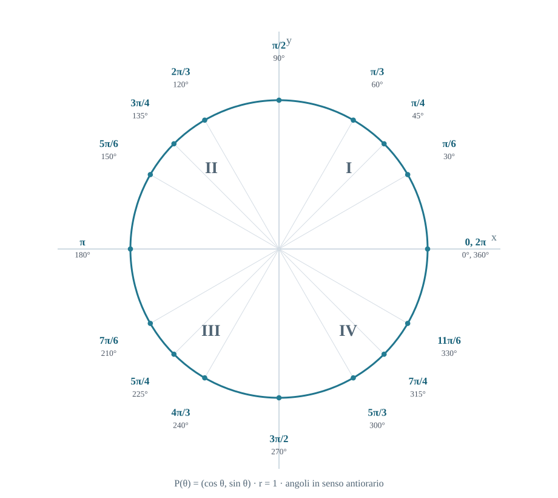

# Analisi 1 · Formulario

*Preliminari · Trigonometria · Limiti*

Trascrizione in Markdown delle due pagine di **Formulario_Analisi_1.pdf**. La numerazione delle sezioni è quella del PDF originale.

## 1 · Logica

- **Contronominale:** $(P\Rightarrow Q)\Leftrightarrow(\neg Q\Rightarrow\neg P)$.
- **Negazione dell'implicazione:** $\neg(P\Rightarrow Q)\Leftrightarrow P\land\neg Q$.
- **De Morgan:** $\neg(P\land Q)\Leftrightarrow\neg P\lor\neg Q$.
- **De Morgan:** $\neg(P\lor Q)\Leftrightarrow\neg P\land\neg Q$.
- **Negazione dei quantificatori:** $\neg(\forall x\,P(x))\Leftrightarrow\exists x\,\neg P(x)$; $\neg(\exists x\,P(x))\Leftrightarrow\forall x\,\neg P(x)$.

## 2 · Estremi e proprietà di R

- **Estremo superiore:** $\sup A=\min\{M\in\mathbb R:M\text{ maggiorante di }A\}$.
- **Estremo inferiore:** $\inf A=\max\{m\in\mathbb R:m\text{ minorante di }A\}$.
- **Archimede:** $\forall x\in\mathbb R\ \exists n\in\mathbb N:n>x$.
- **Conseguenza:** $\forall\varepsilon>0\ \exists n\in\mathbb N:1/n<\varepsilon$.
- **Densità di Q in R:** $a,b\in\mathbb R,\ a<b\Rightarrow\exists q\in\mathbb Q:a<q<b$.

## 3 · Valore assoluto

**Attenzione:**

$$
\sqrt{x^2}=\lvert x\rvert
$$

## 4 · Funzioni

- **Iniettiva:** $\forall x_1,x_2\in A,\ x_1\neq x_2\Rightarrow f(x_1)\neq f(x_2)$.
- **Suriettiva:** $\forall y\in B\ \exists x\in A:f(x)=y$.
- **Composizione:** $(g\circ f)(x)=g(f(x))$.
- **Dominio della composizione:** $\mathrm{Dom}(g\circ f)=\{x\in\mathrm{Dom}\,f:f(x)\in\mathrm{Dom}\,g\}$.
- **Invertibile:** $f$ invertibile $\Leftrightarrow f$ biiettiva.
- **Inversa:** $f^{-1}(f(x))=x$; $f(f^{-1}(y))=y$.
- **Grafico dell'inversa:** riflesso del grafico di $f$ rispetto alla retta $y=x$.
- **Limitata:** $\exists M>0:\lvert f(x)\rvert\le M$ per ogni $x\in\mathrm{Dom}\,f$.
- **Pari:** $f(-x)=f(x)$; **dispari:** $f(-x)=-f(x)$.
- **Crescente:** $x_1<x_2\Rightarrow f(x_1)\le f(x_2)$.
- **Decrescente:** $x_1<x_2\Rightarrow f(x_1)\ge f(x_2)$.

Con le disuguaglianze strette si ottiene la **stretta monotonia**, che implica l'iniettività.

**Continuità a tratti:** nel punto di raccordo $a$ deve valere $\lim_{x\to a^-}f(x)=\lim_{x\to a^+}f(x)=f(a)$.

**Teorema degli zeri:**

$$
f\in C([a,b]),\quad f(a)f(b)<0\ \Rightarrow\ \exists c\in(a,b):f(c)=0
$$

## 5 · Funzioni elementari

**Retta** passante per $(x_0,y_0)$ con coefficiente angolare $m$:

$$
y-y_0=m(x-x_0)
$$

**Esponenziale:** $f(x)=a^x$, $a>0$, $a\neq1$.

- Dominio: $\mathbb R$; immagine: $(0,+\infty)$; $a^0=1$.
- $a>1$: crescente; $0<a<1$: decrescente.

**Logaritmo:** $\log_a x$, inversa di $a^x$.

- Dominio: $(0,+\infty)$; immagine: $\mathbb R$.
- $\log_a1=0$; $\log_a a=1$.

$$
\log_a(xy)=\log_a x+\log_a y
$$

$$
\log_a(x/y)=\log_a x-\log_a y
$$

$$
\log_a(x^r)=r\log_a x
$$

**Limite del logaritmo naturale:**

$$
\lim_{x\to0^+}\ln x=-\infty
$$

**Cambio di base:**

$$
\log_a x=\frac{\log_b x}{\log_b a}=\frac{\ln x}{\ln a}
$$

**Funzioni iperboliche:**

$$
\sinh x=\frac{e^x-e^{-x}}2,\qquad\cosh x=\frac{e^x+e^{-x}}2
$$

$$
\cosh^2x-\sinh^2x=1
$$

## 5A · Sviluppi notevoli — u → 0

$$
e^u=1+u+\frac{u^2}{2}+o(u^2)
$$

$$
\ln(1+u)=u-\frac{u^2}{2}+o(u^2)
$$

$$
\sin u=u-\frac{u^3}{6}+o(u^3)
$$

$$
\cos u=1-\frac{u^2}{2}+o(u^2)
$$

$$
\tan u=u+\frac{u^3}{3}+o(u^3)
$$

$$
\arccos u=\frac{\pi}{2}-u-\frac{u^3}{6}+o(u^3)
$$

$$
(1+u)^\alpha=1+\alpha u+\frac{\alpha(\alpha-1)}2u^2+o(u^2)
$$

$$
\sqrt{1+u}=1+\frac u2+o(u)
$$

**Conta che l'argomento $u$ tenda a $0$.** Esempi: per $x\to a$ usa $u=x-a\to0$; per $x\to\infty$ usa $u=1/x\to0$.

## 5B · Equivalenti notevoli — u → 0

$$
\sin u\sim u;\qquad\tan u\sim u;\qquad\arctan u\sim u
$$

$$
1-\cos u\sim\frac{u^2}{2}\qquad\cos u-1\sim-\frac{u^2}{2}
$$

$$
\ln(1+u)\sim u;\qquad\ln(1-u)\sim -u
$$

$$
\ln(\cos u)\sim -\frac{u^2}{2}
$$

$$
\arccos u-\frac{\pi}{2}\sim -u
$$

$$
e^u-1\sim u
$$

$$
a^u-1\sim u\ln a,\qquad a>0,\ a\neq1
$$

$$
(1+u)^\alpha-1\sim\alpha u,\qquad\alpha\neq0
$$

$$
\sqrt{1+u}-1\sim\frac u2\qquad\sqrt{1-u}-1\sim-\frac u2
$$

**Limite notevole del seno (slide 52, angoli in radianti):**

$$
\lim_{u\to0}\frac{\sin u}{u}=1
$$

**Limite notevole della radice:**

$$
\lim_{u\to0}\frac{\sqrt{1+u}-1}{u}=\frac12
$$

**Definizione:**

$$
f\sim g\ \Leftrightarrow\ \frac fg\to1
$$

Le equivalenze asintotiche si possono sostituire nei **prodotti e quozienti**. Nelle **somme e differenze** controllare le cancellazioni; se il primo termine si cancella, usare più termini dello sviluppo.

**Altri limiti notevoli:**

$$
\lim_{u\to0}(1+u)^{1/u}=e
$$

$$
\lim_{n\to+\infty}\left(1+\frac1n\right)^n=e
$$

**Appunto — argomento dei limiti notevoli:** per applicare il limite notevole, l'argomento $u(x)\to0$ deve comparire anche al denominatore (per esempio $\sin u/u$ oppure $(e^u-1)/u$). Se manca, ricavalo moltiplicando e dividendo per il fattore opportuno.

**Esempio:** $\displaystyle\frac{\sin(3x)}x=3\frac{\sin(3x)}{3x}\to3$ per $x\to0$.
**Per $x\to a$:** se compare $x-a$, si può porre $u=x-a$; allora $x=a+u$ e $u\to0$.

## 6 · Trigonometria

- $\sin:\mathbb R\to[-1,1]$ è dispari; $\cos:\mathbb R\to[-1,1]$ è pari.
- Periodo di seno e coseno: $2\pi$.
- $\tan x=\sin x/\cos x$; dominio $\mathbb R\setminus\{\pi/2+k\pi:k\in\mathbb Z\}$.
- $\cot x=\cos x/\sin x$; dominio $\mathbb R\setminus\{k\pi:k\in\mathbb Z\}$.
- Periodo di tangente e cotangente: $\pi$.

**Identità:**

$$
\sin^2x+\cos^2x=1
$$

**Identità utile per i limiti:**

$$
1-\cos x=\frac{\sin^2x}{1+\cos x}=2\sin^2\left(\frac x2\right)
$$

La forma con il denominatore $1+\cos x$ vale quando $\cos x\neq-1$.

$$
1+\tan^2x=\frac1{\cos^2x};\qquad1+\cot^2x=\frac1{\sin^2x}
$$

**Addizione e sottrazione:**

$$
\sin(x\pm y)=\sin x\cos y\pm\cos x\sin y
$$

$$
\cos(x\pm y)=\cos x\cos y\mp\sin x\sin y
$$

$$
\tan(x\pm y)=\frac{\tan x\pm\tan y}{1\mp\tan x\tan y}
$$

**Angolo doppio:**

$$
\sin2x=2\sin x\cos x
$$

$$
\cos2x=\cos^2x-\sin^2x=2\cos^2x-1=1-2\sin^2x
$$

$$
\tan2x=\frac{2\tan x}{1-\tan^2x}
$$

**Angolo metà:**

$$
\sin^2(x/2)=\frac{1-\cos x}2;\qquad
\cos^2(x/2)=\frac{1+\cos x}2
$$

**Funzioni trigonometriche inverse:**

$$
\arcsin:[-1,1]\to[-\pi/2,\pi/2]
$$

$$
\arccos:[-1,1]\to[0,\pi]
$$

$$
\arcsin(\sin x)=x\quad\text{per }x\in[-\pi/2,\pi/2]
$$

$$
\arccos(\cos x)=x\quad\text{per }x\in[0,\pi]
$$

$$
\arctan(\tan x)=x\quad\text{per }x\in(-\pi/2,\pi/2)
$$

## 6A · Numeri complessi — formule

**Forma algebrica:**

$$
z=x+iy,\quad i^2=-1,\quad\mathrm{Re}\,z=x,\quad\mathrm{Im}\,z=y
$$

**Coniugato e modulo:**

$$
\bar z=x-iy,\quad\lvert z\rvert=\sqrt{x^2+y^2}
$$

$$
z\bar z=\lvert z\rvert^2,\qquad
\frac1z=\frac{\bar z}{\lvert z\rvert^2}\quad(z\neq0)
$$

**Eulero:**

$$
e^{i\theta}=\cos\theta+i\sin\theta
$$

$$
z=re^{i\theta}=r(\cos\theta+i\sin\theta),\qquad r=\lvert z\rvert
$$

$$
x=r\cos\theta,\qquad y=r\sin\theta
$$

**Operazioni:**

$$
z_1\pm z_2=(x_1\pm x_2)+i(y_1\pm y_2)
$$

$$
z_1z_2=r_1r_2e^{i(\theta_1+\theta_2)}
$$

$$
\frac{z_1}{z_2}=\frac{r_1}{r_2}e^{i(\theta_1-\theta_2)},\qquad z_2\neq0
$$

**Potenze e formula di De Moivre (z noto):**

$$
z^n=r^ne^{in\theta}=r^n[\cos(n\theta)+i\sin(n\theta)],\qquad n\in\mathbb Z
$$

Per $n<0$ occorre $z\neq0$.

**Radici di $z^n=w$**, con $w=\rho e^{i\varphi}$, $\rho=\lvert w\rvert>0$, $n\in\mathbb N$, $n\ge1$:

$$
z_k=\rho^{1/n}e^{i(\varphi+2k\pi)/n},\qquad k=0,\ldots,n-1
$$

Per scegliere $\theta$ (con $z\neq0$), usare il quadrante: sezione 7. Se $w=0$, l'unica soluzione è $z=0$.

## 7 · Circonferenza goniometrica e arctan

$$
P(\theta)=(\cos\theta,\sin\theta),\qquad r=1
$$

Angoli in senso antiorario.

**Angoli notevoli:**

| Radianti | Gradi | Coordinate $(\cos\theta,\sin\theta)$ |
| :---: | :---: | :---: |
| $0,\ 2\pi$ | $0^\circ,\ 360^\circ$ | $(1,0)$ |
| $\pi/6$ | $30^\circ$ | $(\sqrt3/2,\ 1/2)$ |
| $\pi/4$ | $45^\circ$ | $(\sqrt2/2,\ \sqrt2/2)$ |
| $\pi/3$ | $60^\circ$ | $(1/2,\ \sqrt3/2)$ |
| $\pi/2$ | $90^\circ$ | $(0,1)$ |
| $2\pi/3$ | $120^\circ$ | $(-1/2,\ \sqrt3/2)$ |
| $3\pi/4$ | $135^\circ$ | $(-\sqrt2/2,\ \sqrt2/2)$ |
| $5\pi/6$ | $150^\circ$ | $(-\sqrt3/2,\ 1/2)$ |
| $\pi$ | $180^\circ$ | $(-1,0)$ |
| $7\pi/6$ | $210^\circ$ | $(-\sqrt3/2,\ -1/2)$ |
| $5\pi/4$ | $225^\circ$ | $(-\sqrt2/2,\ -\sqrt2/2)$ |
| $4\pi/3$ | $240^\circ$ | $(-1/2,\ -\sqrt3/2)$ |
| $3\pi/2$ | $270^\circ$ | $(0,-1)$ |
| $5\pi/3$ | $300^\circ$ | $(1/2,\ -\sqrt3/2)$ |
| $7\pi/4$ | $315^\circ$ | $(\sqrt2/2,\ -\sqrt2/2)$ |
| $11\pi/6$ | $330^\circ$ | $(\sqrt3/2,\ -1/2)$ |

**Arctan notevoli:**

| $t$ | $\arctan t$ |
| :---: | :---: |
| $-\sqrt3$ | $-\pi/3$ |
| $-1$ | $-\pi/4$ |
| $-\sqrt3/3$ | $-\pi/6$ |
| $0$ | $0$ |
| $\sqrt3/3$ | $\pi/6$ |
| $1$ | $\pi/4$ |
| $\sqrt3$ | $\pi/3$ |

$$
\arctan t\in(-\pi/2,\pi/2),\qquad\lim_{x\to\pm\infty}\arctan x=\pm\frac\pi2
$$

Per l'angolo del punto $P(x,y)$, con $x\neq0$:

$$
\alpha=\arctan(\lvert y/x\rvert)
$$

| Quadrante | Angolo |
| :--- | :--- |
| I | $\theta=\alpha$ |
| II | $\theta=\pi-\alpha$ |
| III | $\theta=\pi+\alpha$ |
| IV | $\theta=2\pi-\alpha$ |

Sugli assi usare gli angoli della circonferenza.

## 8 · Regole dei limiti

$$
\lim(f\pm g)=\lim f\pm\lim g
$$

$$
\lim(fg)=(\lim f)(\lim g)
$$

$$
\lim(f/g)=\frac{\lim f}{\lim g},\qquad\lim g\neq0
$$

$$
\lim[f(x)]^\alpha=(\lim f)^\alpha\quad\text{(se definita)}
$$

**Sottosuccessioni:** se due sottosuccessioni hanno limiti diversi, il limite della successione non esiste.

## 9 · Forme indeterminate e procedura

**Forme:** $0/0$, $\infty/\infty$, $0\cdot\infty$, $\infty-\infty$, $1^\infty$, $0^0$, $\infty^0$.

**1. Sostituzione diretta.** Se la forma non è indeterminata, concludi.

**2. Se è indeterminata, scegli la trasformazione:**

| Forma | Procedura |
| :--- | :--- |
| $0/0$ | Fattorizza e semplifica i fattori comuni; usa limiti notevoli, equivalenti o sviluppi. Con le radici, razionalizza. |
| $\infty/\infty$ | Confronta gli ordini di crescita. Nei polinomi, dividi numeratore e denominatore per la potenza più alta presente. |
| $0\cdot\infty$ | Trasforma il prodotto in un quoziente. |
| $\infty-\infty$ | Raccogli il termine dominante, usa il denominatore comune oppure il coniugato delle radici. |
| $1^\infty,\ 0^0,\ \infty^0$ | Con base positiva, passa al logaritmo e studia il prodotto. |

**Raccoglimento nei polinomi:** se $x\to\infty$, raccogli la potenza di $x$ **maggiore**; se $x\to0$, raccogli la potenza di $x$ **minore** (tra quelle presenti).

**Prodotto trasformato in quoziente:**

$$
fg=\frac{f}{1/g}=\frac{g}{1/f}
$$

**Razionalizzazione:**

$$
\sqrt A-\sqrt B=\frac{A-B}{\sqrt A+\sqrt B}
$$

**Potenze indeterminate, base positiva:**

$$
f^g=e^{g\ln f};\qquad L=\lim(g\ln f)\Rightarrow\lim f^g=e^L
$$

**Promemoria per $1^\infty$:** porta la base nella forma $1+u$ con $u\to0$; dopo la trasformazione esponenziale usa $\ln(1+u)\sim u$.

**3. Controlla il dominio, il segno e i limiti laterali.**

## 10 · Calcolo dei limiti di funzioni — slide 34–44

**Funzioni elementari (slide 35–38):** sono continue nei punti del loro dominio; quindi, se $x_0$ appartiene al dominio,

$$
\lim_{x\to x_0}f(x)=f(x_0).
$$

**Potenze intere positive ($n\in\mathbb N$, slide 35):**

$$
\lim_{x\to+\infty}x^n=+\infty,\qquad
\lim_{x\to-\infty}x^n=
\begin{cases}
+\infty & n\text{ pari},\\
-\infty & n\text{ dispari}.
\end{cases}
$$

**Potenze reali ($x>0$, slide 36):**

| Esponente | $x\to0^+$ | $x\to+\infty$ |
| :--- | :---: | :---: |
| $\alpha>0$ | $x^\alpha\to0$ | $x^\alpha\to+\infty$ |
| $\alpha<0$ | $x^\alpha\to+\infty$ | $x^\alpha\to0$ |

**Esponenziali e logaritmi (slide 37):**

| Base | $a^x$, $x\to+\infty$ | $a^x$, $x\to-\infty$ | $\log_a x$, $x\to0^+$ | $\log_a x$, $x\to+\infty$ |
| :--- | :---: | :---: | :---: | :---: |
| $a>1$ | $+\infty$ | $0$ | $-\infty$ | $+\infty$ |
| $0<a<1$ | $0$ | $+\infty$ | $+\infty$ | $-\infty$ |

**Trigonometria (slide 38):** seno e coseno sono continui; la tangente è continua dove $\cos x\neq0$. Ai bordi:

$$
\lim_{x\to(\pi/2)^-}\tan x=+\infty,\qquad
\lim_{x\to(-\pi/2)^+}\tan x=-\infty.
$$

**Polinomi (slide 39):** per $x\to x_0$ finito, sostituisci $x_0$; per $x\to\pm\infty$, domina il termine di grado più alto:

$$
P(x)=a_nx^n+\cdots+a_0\sim a_nx^n.
$$

**Rapporti di polinomi (slide 40):** se $P$ ha grado $m$ e $Q$ grado $n$, con coefficienti principali $a_m,b_n\neq0$,

$$
\frac{P(x)}{Q(x)}\sim\frac{a_m}{b_n}x^{m-n}
\qquad(x\to\pm\infty).
$$

- $m<n$: limite $0$; $m=n$: limite $a_m/b_n$; $m>n$: limite infinito, con segno da valutare.

**Forma $1/0$ (slide 41):** **non è indeterminata**. Se il numeratore tende a un valore non nullo, studia il segno del denominatore e gli eventuali limiti laterali:

$$
\lim_{x\to3}\frac1{(x-3)^4}=+\infty,\qquad
\lim_{x\to3^-}\frac1{(x-3)^3}=-\infty,\qquad
\lim_{x\to3^+}\frac1{(x-3)^3}=+\infty.
$$

**Funzioni limitate (slide 42):** se $|g(x)|\le M$ e $f(x)\to0$, allora $f(x)g(x)\to0$. Per esempio,

$$
\lim_{x\to0}x\sin\left(\frac1x\right)=0.
$$

**Gerarchia degli infiniti (slide 43; esempi slide 44):** per $x\to+\infty$, esponenziali $\gg$ potenze positive $\gg$ potenze positive di logaritmi:

$$
\lim_{x\to+\infty}\frac{a^x}{x^\alpha}=+\infty
\quad(a>1,\ \alpha>0),
\qquad
\lim_{x\to+\infty}\frac{x^\alpha}{(\log_b x)^\beta}=+\infty
\quad(\alpha,\beta>0,\ b>1).
$$

Esempi:

$$
\lim_{x\to+\infty}\frac{2^x}{x^3}=+\infty,\qquad
\lim_{x\to+\infty}\frac{x^3}{2^x}=0,\qquad
\lim_{x\to+\infty}\frac{(\log x)^2}{\sqrt{x}}=0.
$$

## 11 · Cambio di variabile nei limiti — slide 45–50

**Teorema (slide 46):** se $f(x)\to y_0$ per $x\to x_0$ e $g$ è continua in $y_0$ (quando $y_0$ è finito), oppure ammette limite per $y\to y_0$ (quando $y_0=\pm\infty$), allora:

$$
\lim_{x\to x_0}g(f(x))=\lim_{y\to y_0}g(y).
$$

**Procedura:** poni $y=f(x)$, determina $y\to y_0$ e calcola il limite della funzione esterna $g(y)$.

**Esempi con $y=1/x$ (slide 47):**

$$
\lim_{x\to0^+}e^{1/x}=+\infty,\qquad
\lim_{x\to0^-}e^{1/x}=0,\qquad
\lim_{x\to+\infty}e^{1/x}=1.
$$

**Attenzione:** per $x\to0^+$, $1/x\to+\infty$; per $x\to0^-$, $1/x\to-\infty$.

**Altri esempi di composizione (slide 48):**

$$
\lim_{x\to1^+}\arctan\left(\frac1{x-1}\right)=\frac\pi2,\qquad
\lim_{x\to+\infty}\log\left(\sin\frac1x\right)=-\infty.
$$

**Trucco: $t=1/x$ (slide 49).** Trasforma i limiti per $x\to0$ in limiti all'infinito, utili per confrontare potenze, logaritmi ed esponenziali.

$$
t=\frac1x\quad\Longleftrightarrow\quad x=\frac1t
$$

$$
x\to0^+\ \Longrightarrow\ t\to+\infty,\qquad
x\to0^-\ \Longrightarrow\ t\to-\infty
$$

Viceversa: $x\to+\infty\Rightarrow t\to0^+$ e $x\to-\infty\Rightarrow t\to0^-$.

Per $\alpha>0$ e $x\to0^+$:

$$
x^\alpha\log x=\frac1{t^\alpha}\log\left(\frac1t\right)
=-\frac{\log t}{t^\alpha}\longrightarrow0\qquad(t\to+\infty).
$$

**Perché funziona:** $t^\alpha$ cresce più velocemente di $\log t$. La sostituzione non è obbligatoria: usala quando semplifica il limite.

**Esempio della slide 50:** per $x\to0^+$, usa la trasformazione delle potenze indeterminate già riportata nella **sezione 9**. Poiché $x\ln x\to0$:

$$
\lim_{x\to0^+}x^x
=\lim_{x\to0^+}e^{x\ln x}=e^0=1.
$$

## 13 · Gerarchia di crescita — n → +∞

$$
\ln n\ll n^\alpha\ll a^n\ll n!\ll n^n,\qquad\alpha>0,\ a>1
$$

**Per $x\to0^+$:**

$$
\lim_{x\to0^+}x^\alpha\ln x=0,\qquad\alpha>0
$$

---

*Fonte: Formulario_Analisi_1.pdf, pagine 1–2. Circonferenza goniometrica riprodotta in SVG e coordinate trascritte anche in tabella.*
