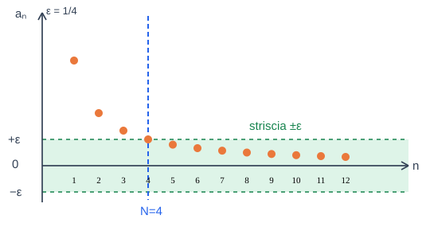
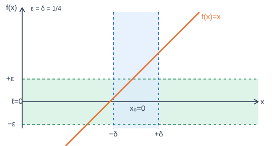
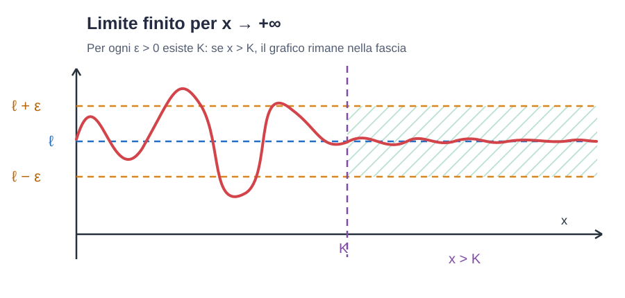

# Limiti di funzioni

Appunti della **lezione del 12/10/2026**, confrontati con i **limiti di successioni** delle lezioni precedenti.

Le due colonne affiancano gli stessi concetti, **quando il parallelismo è corretto**. Le formule sono mantenute brevi per facilitare la lettura su GitHub.

## 1. Esempio introduttivo: teorema del confronto

| Limiti di successioni — lezione 07/10 | Limiti di funzioni — lezione 12/10, pagina 15 |
| :--- | :--- |
| Consideriamo $a_n=\frac{(-1)^n}{n}$. | Consideriamo $f(x)=x\sin(\frac{1}{x})$, con $x\neq 0$. |
| La parte oscillante soddisfa $-1\leq(-1)^n\leq 1$. | La parte oscillante soddisfa $-1\leq\sin(1/x)\leq 1$. |
| Quindi $-\frac{1}{n}\leq a_n\leq\frac{1}{n}$, per $n\geq1$. | Quindi $-\lvert x\rvert\leq f(x)\leq\lvert x\rvert$. |
| Poiché $\frac{1}{n}\to0$ e $-\frac{1}{n}\to0$, per confronto **$a_n\to0$**. | Poiché $\lvert x\rvert\to0$ e $-\lvert x\rvert\to0$ per $x\to0$, per confronto **$\lim_{x\to0}f(x)=0$**. |

**Idea comune:** il termine oscillante non ha bisogno di convergere: il fattore che tende a zero lo comprime tra due quantità che tendono a zero.

**Differenza:** nella successione l'indice $n$ cresce senza limite; nella funzione l'argomento $x$ si avvicina a $0$ da entrambi i lati. Inoltre, $f(0)$ **non è definita**, ma il limite esiste comunque.

## 2. Intorni (lezione 12/10, pagina 18)

Un **intorno** descrive matematicamente quali punti sono vicini a un punto fissato. Il collegamento con le successioni è la nozione di **soglia**.

| Limiti di successioni — lezione 30/09 | Limiti di funzioni — lezione 12/10, pagina 18 |
| :--- | :--- |
| Per $n\to+\infty$ consideriamo tutti gli indici oltre una soglia: **$n>N$**. | Per $x\to x_0$ consideriamo un **intorno di $x_0$** di raggio $r>0$: **$I_r(x_0)=(x_0-r,\ x_0+r)$**. |
| Gli indici considerati appartengono alla semiretta $(N,+\infty)$ (e sono naturali). | I punti dell'intorno verificano **$\lvert x-x_0\rvert<r$**; gli estremi sono esclusi. |
| Per un limite finito $\ell$, da un certo indice in poi vale $\lvert a_n-\ell\rvert<\varepsilon$. | Per un limite finito $\ell$, richiederemo $\lvert f(x)-\ell\rvert<\varepsilon$ quando $x$ è sufficientemente vicino a $x_0$ (definizione formale a pagina 24). |

**Esempio di intorno di un punto reale:** per $x_0=3$ e $r=0{,}5$,

$$
I_{0{,}5}(3)=(3-0{,}5,\ 3+0{,}5)=(2{,}5,\ 3{,}5).
$$

### Intorni di infinito

| Successioni | Funzioni |
| :--- | :--- |
| La condizione $n>N$ significa che l'indice è in un intorno di $+\infty$, limitandosi agli interi naturali. | Un intorno di $+\infty$ è $(a,+\infty)$, con $a\in\mathbb{R}$. |
| Le successioni studiate qui hanno indice $n\to+\infty$. | Per le funzioni si considera anche $x\to-\infty$: un suo intorno è $(-\infty,a)$. |

**Attenzione:** $r$ (o $\delta$ nelle definizioni successive) controlla la vicinanza **dell'argomento** a $x_0$; $\varepsilon$ controlla la vicinanza **dei valori** della funzione al limite $\ell$. Non sono intercambiabili.

---

## 3. Punti di accumulazione (pagina 19 del PDF)

La slide introduce i **punti di accumulazione di un insieme** $D\subseteq\mathbb{R}$: non è ancora una definizione di limite di funzione.

| Limiti di successioni — lezioni precedenti | Punti di accumulazione — lezione 12/10 |
| :--- | :--- |
| Il limite $a_n\to\ell$ descrive il comportamento dei **termini** quando $n\to+\infty$. | $x_0$ è di accumulazione per $D$ se in **ogni suo intorno** c'è almeno un punto di $D$ **diverso da $x_0$**. |
| Per ogni $\varepsilon>0$ esiste $N$ tale che **per tutti** gli $n>N$ vale $\lvert a_n-\ell\rvert<\varepsilon$. | Per ogni $\delta>0$ **esiste almeno un** $x\in D$ tale che $0<\lvert x-x_0\rvert<\delta$. |
| Il limite $\ell$ può non essere un termine della successione. | Il punto $x_0$ può non appartenere all'insieme $D$. |
| **Tutti i termini sufficientemente avanti** devono avvicinarsi a $\ell$. | È sufficiente trovare **almeno un punto diverso da $x_0$ in ogni intorno**. |

**Definizione della slide:**

$$
\forall\delta>0\ \exists x\in D:\ 0<|x-x_0|<\delta.
$$

**Collegamento tramite successioni (conseguenza della definizione):** $x_0$ è di accumulazione per $D$ se e solo se esiste **una successione** $(x_n)$ di elementi di $D\setminus\{x_0\}$ tale che $x_n\to x_0$. Non è necessario che *ogni* successione di punti di $D$ converga a $x_0$.

## 4. Esempi di punti di accumulazione (pagina 21 del PDF)

### Esempio A: intervallo e punto isolato

$$
A=(1,4]\cup\{6\},
\qquad \mathrm{Acc}(A)=[1,4]
$$

| Successioni — parallelismo | Punti di accumulazione — spiegazione |
| :--- | :--- |
| $x_n=1+\frac1n\to1$, con $x_n\in A$ e $x_n\neq1$. | **$1$ è di accumulazione**, anche se $1\notin A$: i punti di $A$ si avvicinano a $1$ da destra. |
| $y_n=4-\frac1n\to4$, con $y_n\in A$ e $y_n\neq4$. | **$4$ è di accumulazione**: ci sono punti di $A$ arbitrariamente vicini a $4$ da sinistra. |
| Non può esistere una successione di punti di $A\setminus\{6\}$ che converga a $6$. | **$6$ è isolato**, perché $(5,7)\cap A=\{6\}$: togliendo il punto $6$, l'intorno non contiene altri punti di $A$. |
| Anche ogni $c\in(1,4)$ può essere avvicinato con punti distinti di $A$. | Tutti i punti tra $1$ e $4$ sono di accumulazione. |

### Esempio B: i reciproci dei naturali

$$
B=\{\,\frac1n:n=1,2,3,\ldots\,\}.
$$

| Successioni — parallelismo | Punti di accumulazione — spiegazione |
| :--- | :--- |
| $b_n=\frac1n\to0$. | **$0$ è di accumulazione**: esistono elementi di $B$ arbitrariamente vicini a $0$, anche se $0\notin B$. |
| Per ogni termine fissato $b_m=\frac1m$ ci sono un precedente e un successivo distinti, salvo il primo. | Ogni $\frac1m$ è un **punto isolato** di $B$: esiste un suo intorno abbastanza piccolo senza altri elementi di $B$. |
| Il limite della successione è $0$. | Il **solo** punto di accumulazione di $B$ è $0$: $\mathrm{Acc}(B)=\{0\}$. |

**Attenzione:** il fatto che la successione $1/n$ converga a $0$ non rende ogni suo termine un punto di accumulazione dell'insieme dei suoi valori.

## 5. Verifica con la definizione (pagina 22 del PDF)

La pagina dimostra che $0$ è di accumulazione per $B$ scegliendo un elemento $1/n$ sufficientemente vicino a $0$.

| Successioni — limite già conosciuto | Insieme $B$ — verifica del punto di accumulazione |
| :--- | :--- |
| $\frac1n\to0$: fissato $\varepsilon>0$, per **tutti** gli $n>1/\varepsilon$ vale $\lvert\frac1n-0\rvert<\varepsilon$. | Fissato $\delta>0$, basta **scegliere un** $n\in\mathbb N$, $n\ge1$, con $n>1/\delta$: allora $0<\frac1n<\delta$. |
| La condizione riguarda **tutti i termini da una certa soglia in poi**. | La definizione richiede **l'esistenza di un punto** di $B$ nell'intorno, diverso da $0$. |

Passaggi:

$$
0<\frac1n<\delta
\quad\Longleftrightarrow\quad
n>\frac1\delta.
$$

Per la proprietà di Archimede esiste sempre un naturale che supera $1/\delta$. Quindi

$$
0\in\mathrm{Acc}(B)
$$

**Perché gli altri punti sono isolati?** Per $m\ge2$ i due termini adiacenti a $1/m$ sono ordinati così:

$$
\frac{1}{m+1}<\frac1m<\frac{1}{m-1}.
$$

Possiamo scegliere un intorno sufficientemente piccolo di $1/m$ che non raggiunga i termini vicini (e quindi nessun altro punto di $B$). Anche $1$ è isolato.

---

## 6. Punto di accumulazione e limite — pagina 23

Consideriamo nuovamente la funzione della pagina 15:

$$
f(x)=x\sin(1/x),\qquad D=\mathbb{R}\setminus\{0\}.
$$

Il punto $x_0=0$ **non appartiene al dominio**, ma è un **punto di accumulazione di $D$**: possiamo avvicinarci a $0$ con punti di $D$ diversi da $0$.

| Limiti di successioni | Limiti di funzioni — pagina 23 |
| :--- | :--- |
| Per $a_n=1/n$ cerchiamo una soglia $N$ oltre la quale $\lvert a_n\rvert<\varepsilon$. | Per $f(x)=x\sin(1/x)$ cerchiamo un raggio $\delta$ tale che $\lvert f(x)\rvert<\varepsilon$ se $x$ è vicino a $0$. |
| Basta scegliere $N\geq1/\varepsilon$: per tutti gli $n>N$ vale $1/n<\varepsilon$. | Basta scegliere **$\delta=\varepsilon$**: se $0<\lvert x\rvert<\delta$, allora $\lvert f(x)\rvert\leq\lvert x\rvert<\varepsilon$. |
| Quindi $\lim_{n\to+\infty}1/n=0$. | Quindi $\lim_{x\to0}x\sin(1/x)=0$. |

**Verifica:**

$$
\lvert\sin(1/x)\rvert\leq1
\quad\Longrightarrow\quad
\lvert f(x)\rvert\leq\lvert x\rvert.
$$

Fissato $\varepsilon>0$, scegliamo $\delta=\varepsilon$. Per ogni $x\in D$ con $0<\lvert x\rvert<\delta$:

$$
\lvert f(x)-0\rvert\leq\lvert x\rvert<\delta=\varepsilon.
$$

**Nota:** $f(0)$ non è definita, ma questo non impedisce l'esistenza del limite.

## 7. Definizione di limite finito — pagina 24

Siano $D\subseteq\mathbb{R}$, $f:D\to\mathbb{R}$ e $x_0$ un **punto di accumulazione di $D$**. Il numero $\ell$ è il limite di $f(x)$ per $x\to x_0$ quando:

$$
\forall\varepsilon>0\quad\exists\delta>0
$$

tale che, **per ogni $x\in D$**,

$$
0<\lvert x-x_0\rvert<\delta
\quad\Longrightarrow\quad
\lvert f(x)-\ell\rvert<\varepsilon.
$$

Si scrive:

$$
\lim_{x\to x_0}f(x)=\ell.
$$

### Parallelismo con la definizione delle successioni

| Successioni — lezione 30/09 | Funzioni — lezione 12/10 |
| :--- | :--- |
| $\lim_{n\to+\infty}a_n=\ell$. | $\lim_{x\to x_0}f(x)=\ell$. |
| Si fissa **$\varepsilon>0$**. | Si fissa **$\varepsilon>0$**. |
| Si trova una **soglia $N$**. | Si trova un **raggio $\delta>0$**. |
| Per ogni $n>N$: $\lvert a_n-\ell\rvert<\varepsilon$. | Per ogni $x\in D$ con $0<\lvert x-x_0\rvert<\delta$: $\lvert f(x)-\ell\rvert<\varepsilon$. |

**Differenza:** nella successione consideriamo tutti gli indici oltre $N$; nella funzione tutti i punti del dominio sufficientemente vicini a $x_0$, **escluso $x_0$**.

**Osservazione della slide:** il valore $f(x_0)$ è irrilevante. Può essere non definito oppure diverso da $\ell$.

## 8. Interpretazione grafica — pagina 25

La condizione

$$
\lvert f(x)-\ell\rvert<\varepsilon
$$

è equivalente a:

$$
\ell-\varepsilon<f(x)<\ell+\varepsilon.
$$

**$\varepsilon$** determina una **striscia orizzontale** attorno al valore del limite $\ell$; **$\delta$** delimita sull'asse delle $x$ un intorno di $x_0$. In quell'intorno (escluso $x_0$), i valori della funzione devono rimanere nella striscia.

### Grafici a due colonne

| Limiti di successioni | Limiti di funzioni |
| :--- | :--- |
| 4 sono nella striscia epsilon" width="420"> |  |
| **Esempio:** $a_n=1/n$, $\ell=0$, $\varepsilon=1/4$, $N=4$. | **Esempio illustrativo:** $f(x)=x$, $x_0=\ell=0$, $\delta=\varepsilon=1/4$. |
| Per **tutti** gli interi $n>4$, i punti restano nella striscia. | Per **tutti** gli $x$ con $0<\lvert x\rvert<1/4$, il grafico resta nella striscia. |
| Grafico formato da **punti discreti**; troviamo una soglia **$N$**. | Grafico di una funzione sui reali; troviamo un intorno **$(x_0-\delta,x_0+\delta)$**. |

**Concetto comune:** fissiamo la tolleranza $\varepsilon$ attorno al limite; poi troviamo la condizione necessaria perché **tutti i valori richiesti** vi restino: $n>N$ oppure $0<\lvert x-x_0\rvert<\delta$.

**Nota sul grafico:** la pagina 25 usa la funzione **f(x) = x** per illustrare la definizione. L'esempio specifico della pagina 23 è invece **f(x) = x sin(1/x)**.

---

## 9. Tre esempi di limite in un punto — pagina 26

La slide mostra tre funzioni con $x\to0$ per chiarire un punto essenziale: **il limite descrive i valori vicino a $0$, non necessariamente il valore in $0$**.

### Esempi e parallelismo con le successioni

| Limiti di successioni — analogie | Limiti di funzioni — pagina 26 |
| :--- | :--- |
| **Costante:** $a_n=4$ per ogni $n$. Quindi $\lim_{n\to+\infty}a_n=4$. | **Costante:** $f(x)=4$ per ogni $x\in\mathbb{R}$. Quindi $\lim_{x\to0}f(x)=4$. |
| **Un termine diverso:** $a_1=7$ e $a_n=4$ per $n\ge2$. Quindi $\lim_{n\to+\infty}a_n=4$. | **Valore nel punto diverso:** $f(0)=7$ e $f(x)=4$ per $x\neq0$. Quindi $\lim_{x\to0}f(x)=4$. |
| **Quadrati:** $a_n=1/n^2$ e $a_n\to0$ quando $n\to+\infty$. | **Funzione quadratica:** $f(x)=x^2$ e $\lim_{x\to0}x^2=0$. |

### 9.1. Funzione costante

Per $f(x)=4$, vogliamo dimostrare che il limite è $\ell=4$:

$$
\lvert f(x)-4\rvert=\lvert4-4\rvert=0<\varepsilon.
$$

La condizione vale per **qualsiasi $\delta>0$**.

### 9.2. Funzione con un valore diverso in $x=0$

Poniamo $f(x)=4$ se $x\neq0$, ma $f(0)=7$.

Per ogni $x$ con $0<\lvert x\rvert<\delta$ abbiamo $x\neq0$, dunque:

$$
\lvert f(x)-4\rvert=0<\varepsilon.
$$

Quindi il limite è **$4$ e non $7$**: nella definizione di limite il punto $x=0$ è escluso. Analogamente, **modificare un numero finito di termini non cambia il limite di una successione**.

### 9.3. Funzione quadratica e scelta di delta

Per $f(x)=x^2$ vogliamo verificare:

$$
\lim_{x\to0}x^2=0.
$$

Fissiamo **$\varepsilon>0$**: è la tolleranza richiesta per i **valori della funzione**.

$$
\lvert f(x)-0\rvert=\lvert x^2\rvert=x^2<\varepsilon.
$$

Risolviamo questa disuguaglianza rispetto a $x$:

$$
x^2<\varepsilon
\quad\Longleftrightarrow\quad
\lvert x\rvert<\sqrt{\varepsilon}.
$$

La definizione di limite richiede invece una condizione sulla distanza di **$x$ da $0$**:

$$
0<\lvert x\rvert<\delta.
$$

Perciò possiamo **scegliere**:

$$
\delta=\sqrt{\varepsilon}.
$$

Allora, per ogni $x$ con $0<\lvert x\rvert<\delta$,

$$
\lvert f(x)-0\rvert=x^2<\delta^2=\varepsilon.
$$

### Perché compaiono sia epsilon sia delta?

| Successioni | Funzioni |
| :--- | :--- |
| **$\varepsilon$** è la tolleranza sui valori $a_n$; si ricava una soglia **$N$** sull'indice. | **$\varepsilon$** è la tolleranza sui valori $f(x)$; si ricava un raggio **$\delta$** per la distanza di $x$ da $x_0$. |
| Per $a_n=1/n^2$ basta $n>1/\sqrt{\varepsilon}$. | Per $f(x)=x^2$ basta $0<\lvert x\rvert<\sqrt{\varepsilon}$. |
| La scelta della soglia **dipende da $\varepsilon$**. | La scelta di **$\delta$ dipende da $\varepsilon$ e dalla funzione**. |

**Non stiamo scambiando $\varepsilon$ e $\delta$.** Prima scegliamo $\varepsilon$, poi troviamo un $\delta$ che garantisca quella tolleranza. Per $f(x)=x^2$ funziona $\delta=\sqrt{\varepsilon}$; per altre funzioni la scelta può essere diversa.

---

## 10. Funzioni continue — lezione 14/10, pagina 1 (slide 10/80)

Il **limite** descrive cosa succede ai valori $f(x)$ quando $x\to x_0$. La **continuità** collega il limite al valore **effettivo** della funzione nel punto $x_0$.

### Definizione

Sia $f:D\to\mathbb R$ e sia $x_0\in D$. La funzione è **continua in $x_0$** quando:

$$
\forall\varepsilon>0\quad\exists\delta>0
$$

tale che, per ogni $x\in D$,

$$
\lvert x-x_0\rvert<\delta
\quad\Longrightarrow\quad
\lvert f(x)-f(x_0)\rvert<\varepsilon.
$$

Quando **$x_0$ è punto di accumulazione di $D$**, questa definizione equivale a:

$$
\lim_{x\to x_0}f(x)=f(x_0).
$$

| Limiti di successioni — collegamento | Limiti di funzioni e continuità |
| :--- | :--- |
| Per $a_n\to\ell$, i termini si avvicinano al limite $\ell$ quando $n$ cresce. | Per $\lim_{x\to x_0}f(x)=\ell$, i valori si avvicinano a $\ell$ quando $x$ si avvicina a $x_0$. |
| Il limite di successione non deve coincidere con un termine della successione. | Per la **continuità** il valore $f(x_0)$ deve esistere e, se $x_0$ è di accumulazione, deve essere uguale a $\ell$. |
| Nella definizione di limite consideriamo $n>N$. | Nella definizione di continuità consideriamo $\lvert x-x_0\rvert<\delta$, **includendo il punto $x_0$**. |

### Esempi aggiuntivi

**Continuità di $f(x)=x^2$ in $x_0=2$:**

$$
f(2)=4,\qquad\lim_{x\to2}x^2=4.
$$

Il limite coincide con $f(2)$: la funzione è **continua in $2$**.

**Non continuità:** $f(0)=7$, mentre $f(x)=4$ per ogni $x\neq0$.

$$
\lim_{x\to0}f(x)=4\neq7=f(0).
$$

Il limite esiste, ma la funzione **non è continua in $0$**.

**Metodo negli esercizi (per un punto di accumulazione):** verifica che $f(x_0)$ sia definito; calcola il limite in $x_0$; confronta i due valori.

## 11. Continuità nei punti isolati — lezione 14/10, pagina 2 (appunti)

Gli appunti manoscritti illustrano un caso particolare: **ogni funzione è continua in un punto isolato del suo dominio**.

### Punto isolato

Un punto $x_0\in D$ è **isolato** se esiste un raggio $\delta>0$ per cui:

$$
(x_0-\delta,\ x_0+\delta)\cap D=\{x_0\}.
$$

Nell'intorno scelto, quindi, **non ci sono punti del dominio diversi da $x_0$**.

### Perché la continuità è automatica?

La continuità richiede che per tutti gli $x$ del dominio vicini a $x_0$ si abbia:

$$
\lvert f(x)-f(x_0)\rvert<\varepsilon.
$$

Ma se nell'intorno l'unico punto del dominio è $x_0$, l'unico caso da verificare è:

$$
\lvert f(x_0)-f(x_0)\rvert=0<\varepsilon.
$$

La disuguaglianza è vera **qualunque sia il valore $f(x_0)$**.

### Esempio aggiuntivo:

Consideriamo il dominio:

$$
D=\{0\}\cup[2,3].
$$

Vogliamo verificare se **$x_0=0$ è un punto isolato**.

1. **Il dominio resta sempre $D=\{0\}\cup[2,3]$.**
2. Per costruire un **intorno di $x_0=0$**, scegliamo ad esempio **$\delta=1$**:

$$
(x_0-\delta,\ x_0+\delta)=(-1,1).
$$

3. Calcoliamo **l'intersezione tra intorno e dominio**:

$$
(-1,1)\cap(\{0\}\cup[2,3])=\{0\}.
$$

L'intervallo $[2,3]$ fa parte del **dominio**; $(-1,1)$ è il **nuovo intorno di zero** scelto per la verifica. I due intervalli non hanno punti in comune, e il solo elemento del dominio dentro l'intorno è $0$.

Conclusione: **$0$ è isolato**; dunque ogni funzione $f:D\to\mathbb R$ è continua in $0$.

Il valore $\delta=1$ è una **scelta comoda, non obbligatoria**: basta scegliere un intorno abbastanza piccolo da non contenere il punto $2$.

### Parallelismo con le successioni

| Successioni | Funzioni |
| :--- | :--- |
| Una successione è una funzione $a:\mathbb N\to\mathbb R$ con $a(n)=a_n$. | Una funzione $f:D\to\mathbb R$ è continua automaticamente nei **punti isolati di $D$**. |
| Ogni $n\in\mathbb N$ è isolato: $(n-1/2,n+1/2)\cap\mathbb N=\{n\}$. | Quindi **ogni successione, vista come funzione su $\mathbb N$, è continua in ogni indice**, anche se non converge per $n\to+\infty$. |
| Il limite della successione riguarda il comportamento degli indici **all'infinito**. | In un punto isolato la continuità **non richiede di calcolare un limite nel punto**: quel limite non è definito secondo la definizione del corso. |

**Da ricordare:** un **punto di accumulazione** consente di avvicinarsi con altri punti del dominio; un **punto isolato** ha un intorno che non contiene altri punti del dominio.

---

## 12. Limite destro e limite sinistro — lezione 14/10, pagine 4–5 (slide 11/80 e appunti)

La funzione può comportarsi diversamente quando ci avviciniamo a $x_0$ **da destra** oppure **da sinistra**.

### Limite destro

La scrittura

$$
\lim_{x\to x_0^+}f(x)=\ell
$$

significa che consideriamo **solo $x>x_0$**, sempre più vicini a $x_0$. Per esempio, verso $x_0=1$: $1{,}1;\ 1{,}01;\ 1{,}001;\ldots$

**Definizione formale** (se $x_0$ è punto di accumulazione di $D\cap(x_0,+\infty)$):

$$
\forall\varepsilon>0\quad\exists\delta>0
$$

tale che per ogni $x\in D\cap(x_0,x_0+\delta)$:

$$
\lvert f(x)-\ell\rvert<\varepsilon.
$$

### Limite sinistro

La scrittura

$$
\lim_{x\to x_0^-}f(x)=\ell
$$

significa che consideriamo **solo $x<x_0$**, sempre più vicini a $x_0$. Per esempio, verso $x_0=1$: $0{,}9;\ 0{,}99;\ 0{,}999;\ldots$

**Definizione formale** (se $x_0$ è punto di accumulazione di $D\cap(-\infty,x_0)$):

$$
\forall\varepsilon>0\quad\exists\delta>0
$$

tale che per ogni $x\in D\cap(x_0-\delta,x_0)$:

$$
\lvert f(x)-\ell\rvert<\varepsilon.
$$

### I tre intorni da distinguere

| Successioni — interpretazione | Funzioni — intorno considerato |
| :--- | :--- |
| Possiamo prendere punti $x_n>x_0$ con $x_n\to x_0$ per studiare l'avvicinamento da destra. | **Destro:** $D\cap(x_0,x_0+\delta)$, indicato con $x\to x_0^+$. |
| Possiamo prendere punti $y_n<x_0$ con $y_n\to x_0$ per studiare l'avvicinamento da sinistra. | **Sinistro:** $D\cap(x_0-\delta,x_0)$, indicato con $x\to x_0^-$. |
| Se il dominio ammette avvicinamenti da entrambi i lati, devono portare allo stesso valore perché esista un limite completo. | **Completo:** $D\cap(x_0-\delta,x_0+\delta)$, escludendo $x_0$. |

**Osservazione degli appunti (pagina 5).** Se il dominio permette l'avvicinamento da entrambi i lati, allora:

$$
\lim_{x\to x_0}f(x)=\ell
\quad\Longleftrightarrow\quad
\lim_{x\to x_0^-}f(x)=
\lim_{x\to x_0^+}f(x)=\ell.
$$

Se i due limiti laterali sono **diversi**, il limite completo **non esiste**. Il simbolo $+$ o $-$ in $x_0^+$ e $x_0^-$ indica **da quale lato ci avviciniamo**, non il segno del limite.

## 13. Esempio di limite laterale per funzione a tratti — lezione 14/10, pagina 6 (slide 12/80)

La funzione della slide è:

$$
f(x)=
\begin{cases}
x+4 & \text{se }x\leq1,\\
-3x+2 & \text{se }x>1.
\end{cases}
$$

Vogliamo calcolare il limite per $x\to1$.

### Passaggio 1: da sinistra ($x<1$)

Usiamo **il primo ramo**:

$$
\lim_{x\to1^-}f(x)
=\lim_{x\to1^-}(x+4)
=1+4=5.
$$

### Passaggio 2: da destra ($x>1$)

Usiamo **il secondo ramo**:

$$
\lim_{x\to1^+}f(x)
=\lim_{x\to1^+}(-3x+2)
=-3+2=-1.
$$

### Passaggio 3: confrontiamo

$$
5\neq-1
\quad\Longrightarrow\quad
\nexists\lim_{x\to1}f(x).
$$

Il **limite completo non esiste**, perché i due limiti laterali non coincidono.

**Attenzione:** il valore effettivo della funzione nel punto esiste ed è:

$$
f(1)=1+4=5,
$$

poiché il primo ramo comprende anche $x=1$. Conoscere $f(1)$ **non basta** per stabilire che esista il limite completo.

| Dato | Risultato |
| :--- | :--- |
| Valore della funzione $f(1)$ | $5$ |
| Limite da sinistra | $5$ |
| Limite da destra | $-1$ |
| Limite completo per $x\to1$ | **Non esiste** |

## 14. Continuità da destra e da sinistra — lezione 14/10, pagine 7–8 (slide 13/80 e appunti)

Per parlare di continuità in $x_0$ occorre sempre che **$x_0\in D$**.

**Continuità da destra:** se $x_0$ è di accumulazione per il dominio alla sua destra, allora:

$$
f\text{ continua da destra in }x_0
\quad\Longleftrightarrow\quad
\lim_{x\to x_0^+}f(x)=f(x_0).
$$

**Continuità da sinistra:** se $x_0$ è di accumulazione per il dominio alla sua sinistra, allora:

$$
f\text{ continua da sinistra in }x_0
\quad\Longleftrightarrow\quad
\lim_{x\to x_0^-}f(x)=f(x_0).
$$

### Applichiamolo all'esempio precedente

Per la funzione a tratti della pagina 6:

$$
f(1)=5,\qquad
\lim_{x\to1^-}f(x)=5,\qquad
\lim_{x\to1^+}f(x)=-1.
$$

| Continuità da sinistra | Continuità da destra |
| :--- | :--- |
| Limite sinistro: $5$. | Limite destro: $-1$. |
| Valore nel punto: $f(1)=5$. | Valore nel punto: $f(1)=5$. |
| **$5=5$: continua da sinistra.** | **$-1\neq5$: non continua da destra.** |

La funzione **non è continua in $1$**, perché i comportamenti laterali non coincidono.

Quando il dominio presenta punti arbitrariamente vicini a $x_0$ **da entrambe le parti**, la continuità completa equivale alla continuità da entrambi i lati:

$$
f\text{ continua in }x_0
\quad\Longleftrightarrow\quad
\lim_{x\to x_0^-}f(x)
=\lim_{x\to x_0^+}f(x)
=f(x_0).
$$

### Attenzione al dominio — appunti della pagina 8

La possibilità di studiare i due lati **non è sempre garantita**: il punto deve essere di accumulazione dei punti del dominio presenti sul lato considerato.

**Esempio aggiuntivo:** $D=[0,+\infty)$ e $x_0=0$.

- Possiamo studiare $x\to0^+$: nel dominio ci sono punti positivi arbitrariamente vicini a $0$.
- **Non possiamo** studiare $x\to0^-$: il dominio non contiene valori negativi.

Una funzione definita su $[0,+\infty)$ può comunque essere **continua in $0$**, se il limite da destra coincide con $f(0)$:

$$
\lim_{x\to0^+}f(x)=f(0).
$$

### Un intervallo di reali non è una successione

| Successioni | Funzioni su un intervallo |
| :--- | :--- |
| Il dominio di una successione è $\mathbb N$: i possibili indici $n$ sono **discreti**. | Il dominio $[0,+\infty)$ contiene **tutti i reali non negativi**, anche frazionari. |
| Esempi di indici: $n=0,1,2,3,\ldots$ (se si parte da $0$). | Esempi di argomenti: $x=0;\ 0{,}1;\ 0{,}25;\ 0{,}5;\ 1;\ldots$ |
| Normalmente si studia $\lim_{n\to+\infty}a_n$. | All'estremo del dominio possiamo studiare $\lim_{x\to0^+}f(x)$. |
| Una successione $x_n=1/n$ con $n\geq1$ converge a $0$. | Possiamo usare $x_n=1/n$ come **uno dei modi** di avvicinarci a $0$ da destra; il limite della funzione deve essere valido per **tutti i punti del dominio** sufficientemente vicini a $0$. |

**Conclusione:** una successione è una funzione con dominio $\mathbb N$, ma una funzione definita su $[0,+\infty)$ **non è una successione**.

---

## 15. Limite infinito in un punto — lezione 14/10, pagine 10–11 (slide 15/80 e appunti)

Finora abbiamo studiato funzioni che, quando $x\to x_0$, si avvicinano a un numero reale $\ell$. Un'altra possibilità è che i valori di $f(x)$ diventino **arbitrariamente grandi**.

### Definizione di limite +infinito

Scriviamo:

$$
\lim_{x\to x_0}f(x)=+\infty
$$

se, fissata **qualunque soglia $M>0$**, tutti i valori della funzione sufficientemente vicini a $x_0$ (escluso $x_0$) superano $M$.

**Definizione formale:** sia $x_0$ un punto di accumulazione di $D$.

$$
\forall M>0\quad\exists\delta>0
$$

tale che, per **ogni $x\in D$**,

$$
0<\lvert x-x_0\rvert<\delta
\quad\Longrightarrow\quad
f(x)>M.
$$

### Confronto con il limite finito e con le successioni

| Successioni | Funzioni |
| :--- | :--- |
| **Limite finito:** $a_n\to\ell$ significa che, per ogni $\varepsilon>0$, dopo una soglia $N$ vale $\lvert a_n-\ell\rvert<\varepsilon$. | **Limite finito:** $\lim_{x\to x_0}f(x)=\ell$ significa che, per ogni $\varepsilon>0$, vicino a $x_0$ vale $\lvert f(x)-\ell\rvert<\varepsilon$. |
| **Limite +infinito:** $a_n\to+\infty$ significa che, per ogni $M>0$, esiste $N$ tale che **$n>N\Rightarrow a_n>M$**. | **Limite +infinito:** $\lim_{x\to x_0}f(x)=+\infty$ significa che, per ogni $M>0$, esiste $\delta$ tale che **$0<\lvert x-x_0\rvert<\delta\Rightarrow f(x)>M$**. |
| La soglia $N$ riguarda **l'indice della successione**. | Il raggio $\delta$ riguarda **la distanza di $x$ da $x_0$**. |

**Perché $M$ e non $\varepsilon$?** Per un limite finito chiediamo ai valori di stare *vicino a* $\ell$; per $+\infty$ chiediamo di stare *sopra qualsiasi soglia* $M$. Non stiamo cercando una distanza da $+\infty$, che non è un numero reale.

### Interpretazione grafica — pagina 11 (appunti)

- Nel caso di **limite finito**, il grafico deve entrare nella striscia orizzontale tra $\ell-\varepsilon$ e $\ell+\varepsilon$ quando $x$ è vicino a $x_0$.
- Nel caso di **limite $+\infty$**, per **ogni** retta orizzontale $y=M$, il grafico deve stare **interamente sopra** quella retta per tutti gli $x$ del dominio abbastanza vicini a $x_0$, diversi da $x_0$.

**Attenzione:** non basta che *alcuni* valori di $f(x)$ superino $M$: devono farlo **tutti** nell'intorno scelto, escluso il punto $x_0$.

### Esempio pratico e verifica passo per passo — anticipa la slide 17/80 (pagina 13)

Vogliamo verificare:

$$
\lim_{x\to0}\frac{1}{x^2}=+\infty.
$$

**1. Fissiamo $M>0$.** La definizione ci chiede di rendere vera questa disuguaglianza:

$$
\frac{1}{x^2}>M.
$$

**2. Troviamo quanto vicino a $0$ deve stare $x$.** Poiché $x^2>0$ per $x\neq0$ e $M>0$, possiamo passare ai reciproci, **invertendo il verso**:

$$
\frac{1}{x^2}>M
\quad\Longleftrightarrow\quad
x^2<\frac1M
\quad\Longleftrightarrow\quad
\lvert x\rvert<\frac1{\sqrt M}.
$$

Dunque una scelta possibile è:

$$
\delta=\frac1{\sqrt M}.
$$

**3. Verifichiamo che la scelta funzioni, ripartendo dalla definizione.**

Se:

$$
0<\lvert x\rvert<\delta=\frac1{\sqrt M},
$$

elevando al quadrato otteniamo:

$$
0<x^2<\frac1M.
$$

**4. Passiamo ai reciproci:** dato che i termini sono positivi, il verso della disuguaglianza **si inverte**:

$$
\frac1{x^2}>M.
$$

È **esattamente la condizione richiesta dalla definizione**. Quindi il limite è verificato.

**Schema utile:** fissare $M$ $\rightarrow$ risolvere $f(x)>M$ rispetto alla distanza di $x$ da $x_0$ $\rightarrow$ scegliere $\delta$ $\rightarrow$ partire da $0<\lvert x-x_0\rvert<\delta$ e dimostrare $f(x)>M$.

### Collegamento utile con una successione

| Successione $a_n=n^2$ | Funzione $f(x)=1/x^2$ |
| :--- | :--- |
| Per avere $a_n>M$ basta scegliere **$n>\sqrt M$**. | Per avere $f(x)>M$ basta scegliere **$0<\lvert x\rvert<1/\sqrt M$**. |
| Infatti $n>\sqrt M\Rightarrow n^2>M$. | Infatti $0<x^2<1/M\Rightarrow1/x^2>M$. |
| $\lim_{n\to+\infty}n^2=+\infty$. | $\lim_{x\to0}1/x^2=+\infty$. |

---

## 16. Asintoto verticale — lezione 14/10, pagina 12 (slide 16/80)

Quando:

$$
\lim_{x\to x_0}f(x)=+\infty,
$$

la retta **$x=x_0$** è un **asintoto verticale**.

**Significato grafico della slide:** per ogni $M>0$, anche molto grande, possiamo trovare un intorno abbastanza piccolo di $x_0$ nel quale **tutti** i punti del grafico (con $x\in D$ e $x\neq x_0$) stanno sopra la retta orizzontale **$y=M$**:

$$
0<\lvert x-x_0\rvert<\delta
\quad\Longrightarrow\quad
f(x)>M.
$$

La retta **$y=M$ serve a verificare la definizione**; l'asintoto verticale vero e proprio è **$x=x_0$**.

**Esempio:**

$$
f(x)=\frac1{x^2},\qquad
\lim_{x\to0}\frac1{x^2}=+\infty.
$$

Quindi l'asintoto verticale è **$x=0$**.

| Limiti di successioni — analogia | Limiti di funzioni e grafico |
| :--- | :--- |
| Per $a_n=n^2\to+\infty$, dopo una certa soglia tutti i termini superano $M$. | Per $f(x)=1/x^2$, tutti i valori sufficientemente vicini a $0$ superano $M$. |
| La successione non ha una retta verticale da chiamare asintoto: il suo indice tende a $+\infty$. | La funzione presenta un **asintoto verticale $x=0$**, perché $x$ tende a un punto finito e $f(x)$ diverge. |

**Regola più generale:** la retta $x=x_0$ è un asintoto verticale anche se la funzione tende a $+\infty$ o $-\infty$ **soltanto da un lato**.

## 17. Esempio della slide: limite di 1/x² — lezione 14/10, pagine 13–15 (slide 17/80 e appunti)

Il PDF verifica:

$$
\lim_{x\to0}\frac1{x^2}=+\infty.
$$

Il **procedimento completo in quattro passaggi** è già nella sezione 15. Riassumiamo qui il risultato della dimostrazione.

**Dominio:** $D=\mathbb R\setminus\{0\}$; il punto $0$ è un punto di accumulazione del dominio anche se non vi appartiene.

Fissiamo $M>0$ e imponiamo:

$$
\frac1{x^2}>M
\quad\Longleftrightarrow\quad
0<\lvert x\rvert<\frac1{\sqrt M}.
$$

Scegliamo:

$$
\delta=\frac1{\sqrt M}.
$$

**Verifica, dall'ipotesi alla tesi:**

$$
0<\lvert x\rvert<\delta
\quad\Longrightarrow\quad
0<x^2<\frac1M
\quad\Longrightarrow\quad
\frac1{x^2}>M.
$$

L'ultimo passaggio è corretto perché **passare ai reciproci di numeri positivi inverte la disuguaglianza**.

## 18. Limite uguale a meno infinito — lezione 14/10, pagina 16 (slide 18/80)

Scriviamo:

$$
\lim_{x\to x_0}f(x)=-\infty
$$

quando i valori della funzione, avvicinandosi a $x_0$, diventano **più piccoli di qualsiasi soglia negativa $-M$**.

**Definizione formale** (con $x_0$ punto di accumulazione di $D$):

$$
\forall M>0\quad\exists\delta>0
$$

tale che per ogni $x\in D$:

$$
0<\lvert x-x_0\rvert<\delta
\quad\Longrightarrow\quad
f(x)<-M.
$$

| Limite +infinito | Limite -infinito |
| :--- | :--- |
| $\lim_{x\to x_0}f(x)=+\infty$ | $\lim_{x\to x_0}f(x)=-\infty$ |
| Si deve ottenere **$f(x)>M$**. | Si deve ottenere **$f(x)<-M$**. |
| Il grafico è sopra la retta $y=M$. | Il grafico è sotto la retta $y=-M$. |
| La retta $x=x_0$ è un asintoto verticale. | Anche qui $x=x_0$ è un asintoto verticale. |

### Esempio pratico aggiuntivo

Studiamo:

$$
\lim_{x\to0}-\frac1{x^2}=-\infty.
$$

Fissato $M>0$, dobbiamo rendere vera:

$$
-\frac1{x^2}<-M.
$$

Moltiplicando per $-1$, **il verso si inverte**:

$$
\frac1{x^2}>M
\quad\Longleftrightarrow\quad
0<\lvert x\rvert<\frac1{\sqrt M}.
$$

Scegliamo quindi:

$$
\delta=\frac1{\sqrt M}.
$$

Se $0<\lvert x\rvert<\delta$, allora:

$$
0<x^2<\frac1M
\quad\Longrightarrow\quad
\frac1{x^2}>M
\quad\Longrightarrow\quad
-\frac1{x^2}<-M.
$$

La definizione di limite $-\infty$ è soddisfatta.

## 19. Limiti infiniti destro e sinistro — lezione 14/10, pagine 17–19 (slide 19/80 e appunti)

Le definizioni dei limiti infiniti possono essere applicate **separatamente a destra e a sinistra** di $x_0$, purché il dominio presenti punti arbitrariamente vicini dal lato considerato.

### Esempio della slide: f(x)=1/x

La funzione ha dominio $D=\mathbb R\setminus\{0\}$.

**Da destra:** per $x>0$, il reciproco è positivo e cresce quando $x$ si avvicina a $0$:

$$
\lim_{x\to0^+}\frac1x=+\infty.
$$

Per definizione dobbiamo mostrare che, fissato $M>0$, esiste $\delta>0$ tale che:

$$
0<x<\delta
\quad\Longrightarrow\quad
\frac1x>M.
$$

Risolvendo la condizione per $x>0$:

$$
\frac1x>M
\quad\Longleftrightarrow\quad
x<\frac1M.
$$

Quindi scegliamo **$\delta=1/M$**. Se $0<x<1/M$, prendendo i reciproci positivi otteniamo **$1/x>M$**.

**Da sinistra:** per $x<0$, il reciproco diventa sempre più negativo:

$$
\lim_{x\to0^-}\frac1x=-\infty.
$$

La condizione richiesta è:

$$
-\delta<x<0
\quad\Longrightarrow\quad
\frac1x<-M.
$$

Fissato $M>0$, scegliamo ancora **$\delta=1/M$**. Se:

$$
-\frac1M<x<0,
$$

per esempio moltiplicando la disuguaglianza $\frac1x<-M$ per il numero negativo $x$ (e invertendo il verso) si verifica la condizione equivalente:

$$
1>-Mx
\quad\Longleftrightarrow\quad
x>-\frac1M.
$$

Quindi per ogni $x$ nell'intervallo scelto vale **$1/x<-M$**.

### Conclusione: il limite completo esiste?

| Da sinistra | Da destra |
| :--- | :--- |
| $\lim_{x\to0^-}1/x=-\infty$ | $\lim_{x\to0^+}1/x=+\infty$ |
| I valori sono **negativi** e scendono senza limite. | I valori sono **positivi** e crescono senza limite. |

I limiti laterali **non coincidono**, quindi:

$$
\nexists\lim_{x\to0}\frac1x.
$$

Ciononostante, la retta **$x=0$ è un asintoto verticale**: per stabilirlo è sufficiente un limite laterale infinito.

### Regola pratica: attenzione al segno del denominatore

**Esempio aggiuntivo:**

$$
\lim_{x\to2}\frac1{x-2}.
$$

- Quando $x\to2^-$, il denominatore $x-2$ è **negativo** e tende a $0$: il rapporto tende a $-\infty$.
- Quando $x\to2^+$, il denominatore $x-2$ è **positivo** e tende a $0$: il rapporto tende a $+\infty$.

$$
\lim_{x\to2^-}\frac1{x-2}=-\infty,
\qquad
\lim_{x\to2^+}\frac1{x-2}=+\infty.
$$

Il limite completo **non esiste**, ma la retta **$x=2$ è un asintoto verticale**.

**Da ricordare:** quando il denominatore tende a $0$, non assegnare automaticamente $+\infty$ o $-\infty$: **controlla il segno dell'intera frazione da ciascun lato**. Questa regola vale quando il numeratore tende a un valore non nullo; in caso di forma $0/0$ occorre prima studiare la funzione.

---

## 20. Limite all'infinito — lezione 14/10, pagina 20 (slide 20/80)

Studiamo il comportamento di una funzione quando **$x\to+\infty$** oppure **$x\to-\infty$**. Perché il limite abbia senso, il dominio $D$ deve contenere punti arbitrariamente grandi nel verso considerato.

**Dominio illimitato superiormente:**

$$
\forall K>0\quad\exists x\in D:\ x>K.
$$

**Dominio illimitato inferiormente:**

$$
\forall K>0\quad\exists x\in D:\ x<-K.
$$

| Limiti delle successioni | Limiti delle funzioni |
| :--- | :--- |
| $\mathbb N$ è illimitato superiormente, quindi si considera $n\to+\infty$. | Si studia $x\to+\infty$ solo se $D$ è illimitato superiormente, $x\to-\infty$ solo se è illimitato inferiormente. |
| L'indice $n$ assume valori naturali. | Il dominio può essere $\mathbb R$, un intervallo o un altro sottoinsieme di $\mathbb R$. |

**Esempi:** $D=\mathbb R$ permette entrambe le direzioni; $D=[0,+\infty)$ solo $x\to+\infty$; $D=(-\infty,3]$ solo $x\to-\infty$; $D=[0,5]$ nessuna.

**Non confondere $x\to+\infty$ con $f(x)\to+\infty$.** Per esempio:

$$
\lim_{x\to+\infty}\frac1x=0.
$$

## 21. Limite finito per x che tende a +infinito — lezione 14/10, pagina 21 (slide 21/80)

Per $f:D\to\mathbb R$ con $D$ illimitato superiormente:

$$
\lim_{x\to+\infty}f(x)=\ell
$$

significa:

$$
\forall\varepsilon>0\quad\exists K>0
$$

tale che, per ogni $x\in D$,

$$
x>K\quad\Longrightarrow\quad
\lvert f(x)-\ell\rvert<\varepsilon.
$$

**Interpretazione:** scelta la tolleranza $\varepsilon$, troviamo una soglia $K$ oltre la quale **tutti i valori della funzione** distano da $\ell$ meno di $\varepsilon$.

| Successioni | Funzioni |
| :--- | :--- |
| $\lim_{n\to+\infty}a_n=\ell$. | $\lim_{x\to+\infty}f(x)=\ell$. |
| Per ogni $\varepsilon>0$ troviamo $N$ tale che, se $n>N$, allora $\lvert a_n-\ell\rvert<\varepsilon$. | Per ogni $\varepsilon>0$ troviamo $K>0$ tale che, se $x>K$, allora $\lvert f(x)-\ell\rvert<\varepsilon$. |

### Esempio aggiuntivo: verificare il limite di 1/x

Per verificare $\lim_{x\to+\infty}1/x=0$, fissiamo $\varepsilon>0$ e imponiamo:

$$
\frac1x<\varepsilon
\quad\Longleftrightarrow\quad
x>\frac1\varepsilon
\qquad(x>0).
$$

Scegliamo:

$$
K=\frac1\varepsilon.
$$

Se $x>K$, la disuguaglianza $1/x<\varepsilon$ è verificata.

**Asintoto orizzontale:** se il limite finito è $\ell$, la retta **$y=\ell$** è un asintoto orizzontale per $x\to+\infty$. Per $f(x)=1/x$ è **$y=0$**.

**Distinzione:** asintoto verticale **$x=x_0$** per un limite infinito vicino a un punto; asintoto orizzontale **$y=\ell$** per un limite finito all'infinito.

## 22. Interpretazione grafica — lezione 14/10, pagina 22 (appunti)

Il grafico degli appunti mostra una funzione che può oscillare anche molto prima di $K$; per $x>K$ resta dentro la **striscia orizzontale** intorno a $\ell$.

La striscia è:

$$
\ell-\varepsilon<f(x)<\ell+\varepsilon
\quad\Longleftrightarrow\quad
\lvert f(x)-\ell\rvert<\varepsilon.
$$

**Importante:** la funzione può continuare a oscillare. Deve però restare nella fascia per **tutti gli $x\in D$ con $x>K$**, per ogni $\varepsilon>0$.

## 23. Limiti infiniti all'infinito — lezione 14/10, pagina 23 (slide 22/80)

Quando $D$ è illimitato superiormente, la slide introduce:

**Limite $+\infty$:**

$$
\lim_{x\to+\infty}f(x)=+\infty
$$

$$
\forall M>0\quad\exists K>0:
\quad x\in D,\ x>K
\quad\Longrightarrow\quad f(x)>M.
$$

**Limite $-\infty$:**

$$
\lim_{x\to+\infty}f(x)=-\infty
$$

$$
\forall M>0\quad\exists K>0:
\quad x\in D,\ x>K
\quad\Longrightarrow\quad f(x)<-M.
$$

| Limite finito | Limite infinito |
| :--- | :--- |
| Si fissa **$\varepsilon>0$**, tolleranza attorno a $\ell$. | Si fissa **$M>0$**, soglia positiva o negativa in valore assoluto. |
| Si cerca $K$ tale che $\lvert f(x)-\ell\rvert<\varepsilon$. | Si cerca $K$ tale che $f(x)>M$ oppure $f(x)<-M$. |

### Esercizio della slide: definizioni per x che tende a -infinito

**Svolgimento aggiuntivo:** supponiamo $D$ illimitato inferiormente. Rispetto a $x\to+\infty$ cambia la condizione in **$x<-K$**.

**Limite finito:**

$$
\lim_{x\to-\infty}f(x)=\ell
$$

$$
\forall\varepsilon>0\quad\exists K>0:
\quad x\in D,\ x<-K
\quad\Longrightarrow\quad
\lvert f(x)-\ell\rvert<\varepsilon.
$$

**Limite $+\infty$:**

$$
\lim_{x\to-\infty}f(x)=+\infty
$$

$$
\forall M>0\quad\exists K>0:
\quad x\in D,\ x<-K
\quad\Longrightarrow\quad f(x)>M.
$$

**Limite $-\infty$:**

$$
\lim_{x\to-\infty}f(x)=-\infty
$$

$$
\forall M>0\quad\exists K>0:
\quad x\in D,\ x<-K
\quad\Longrightarrow\quad f(x)<-M.
$$

**Attenzione:** il dominio non è necessariamente $(-\infty,0)$: può essere anche $\mathbb R$. L'importante è che sia illimitato inferiormente.

## 24. Calcolare il limite o verificarlo con la definizione? — chiarimento aggiuntivo

**Le tecniche di calcolo servono a trovare $\ell$. La definizione formale serve a dimostrare che il valore trovato è corretto.**

### 1. Calcolo

$$
\lim_{x\to-\infty}\frac{2x+1}{x}
=\lim_{x\to-\infty}\left(2+\frac1x\right)=2.
$$

Abbiamo individuato **$\ell=2$**.

### 2. Verifica con la definizione

Fissato $\varepsilon>0$, dobbiamo dimostrare:

$$
\lvert f(x)-2\rvert<\varepsilon.
$$

Sostituiamo e semplifichiamo:

$$
\lvert (2x+1)/x-2\rvert
=\frac1{\lvert x\rvert}<\varepsilon.
$$

Poiché $x<0$, questa condizione equivale a:

$$
\lvert x\rvert>\frac1\varepsilon
\quad\Longleftrightarrow\quad
x<-\frac1\varepsilon.
$$

Scegliamo **$K=1/\varepsilon$**. Se $x<-K$, allora $\lvert x\rvert>1/\varepsilon$ e pertanto:

$$
\lvert f(x)-2\rvert
=\frac1{\lvert x\rvert}<\varepsilon.
$$

La definizione è verificata.

| Calcolare | Verificare con la definizione |
| :--- | :--- |
| **Obiettivo:** trovare $\ell$ mediante semplificazioni, proprietà dei limiti, limiti notevoli o equivalenze. | **Obiettivo:** dimostrare che $\ell$ soddisfa la definizione con una scelta adeguata di $K$, $N$ o $\delta$. |
| Nell'esempio troviamo $\ell=2$. | Nell'esempio scegliamo $K=1/\varepsilon$ e verifichiamo la disuguaglianza. |

**Regola per gli esercizi:** «calcola» e «verifica con la definizione» richiedono due procedimenti diversi.

---

## 25. Esempi di limite +infinito all'infinito — lezione 14/10, pagine 24–26 (slide 23/80 e appunti)

La slide propone tre limiti:

$$
\lim_{x\to+\infty}x^3=+\infty,
\qquad
\lim_{x\to+\infty}e^x=+\infty,
\qquad
\lim_{x\to+\infty}\log x=+\infty.
$$

**Nelle pagine 25–26 il professore verifica il primo limite con la definizione**. La verifica degli altri due è qui aggiunta per esercizio.

### 25.1. Verifica della definizione: f(x)=x³ (svolta negli appunti)

La definizione di limite $+\infty$ per $x\to+\infty$ chiede:

$$
\forall M>0\quad\exists K>0:
\quad x>K\Longrightarrow x^3>M.
$$

**Passaggio 1.** Fissiamo un qualsiasi **$M>0$** e imponiamo:

$$
x^3>M.
$$

**Passaggio 2.** Poiché la funzione cubica è crescente, estraiamo la radice cubica senza cambiare il verso:

$$
x>\sqrt[3]{M}.
$$

**Passaggio 3.** Scegliamo quindi:

$$
K=\sqrt[3]{M}.
$$

**Passaggio 4 — Verifica.** Partendo dall'ipotesi $x>K$, otteniamo:

$$
x>K=\sqrt[3]{M}
\quad\Longrightarrow\quad
x^3>M.
$$

Questa è esattamente la condizione richiesta, **per ogni $M>0$**. Quindi il limite è verificato.

### 25.2. Esempi aggiuntivi: esponenziale e logaritmo

**Esponenziale $e^x$.** Imponiamo:

$$
e^x>M
\quad\Longleftrightarrow\quad
x>\ln M
\qquad(M>0).
$$

Poiché la definizione richiede **$K>0$**, basta scegliere:

$$
K=\max\{1,\ln M\}.
$$

Se $x>K$, allora $x>\ln M$ e dunque $e^x>M$.

**Logaritmo.** Interpretando $\log x$ della slide come logaritmo naturale **$\ln x$** (dominio $x>0$), imponiamo:

$$
\ln x>M
\quad\Longleftrightarrow\quad
x>e^M.
$$

Basta scegliere:

$$
K=e^M>0.
$$

Se $x>K$, allora $\ln x>M$: anche questo limite è verificato.

| Limiti di successioni: analogia | Limiti di funzioni: esercizi della slide |
| :--- | :--- |
| Per $a_n=n^3\to+\infty$, basta $n>\sqrt[3]{M}$ per ottenere $a_n>M$. | Per $f(x)=x^3\to+\infty$, basta $x>K=\sqrt[3]{M}$. |
| Per $a_n=e^n\to+\infty$, si trova una soglia sull'indice $n$. | Per $f(x)=e^x\to+\infty$, possiamo usare $K=\max\{1,\ln M\}$. |
| Per $a_n=\ln n\to+\infty$, basta $n>e^M$. | Per $f(x)=\ln x\to+\infty$, basta $K=e^M$. |

**Schema per le verifiche:** fissare $M>0$, risolvere **$f(x)>M$** per ottenere una condizione $x>K$, scegliere $K$ e infine dimostrare l'implicazione partendo da $x>K$.

## 26. Quando la definizione NON verifica un limite? — controesempio aggiuntivo

La definizione è **falsa** per un limite proposto quando non esiste una soglia $K$ che funzioni per **ogni $M>0$**.

### Controesempio: il limite proposto è sbagliato

Supponiamo, erroneamente, di voler verificare:

$$
\lim_{x\to+\infty}\frac1x=+\infty.
$$

La definizione richiederebbe:

$$
\forall M>0\quad\exists K>0:
\quad x>K\Longrightarrow\frac1x>M.
$$

**1. Per smentirla basta trovare un solo valore $M>0$ per cui nessun $K$ funziona.** Scegliamo:

$$
M=1.
$$

**2. La condizione richiesta diventerebbe:**

$$
x>K\quad\Longrightarrow\quad\frac1x>1.
$$

Ma, per $x>0$, risolvendo la disuguaglianza:

$$
\frac1x>1
\quad\Longleftrightarrow\quad
0<x<1.
$$

**3. Contraddizione:** la definizione pretende che **tutti** gli $x>K$ soddisfino $0<x<1$, anche se tra essi ci sono valori arbitrariamente grandi.

In maniera esplicita: **qualsiasi $K>0$ scegliamo**, prendiamo:

$$
x=\max\{K+1,2\}.
$$

Questo $x$ soddisfa $x>K$ ma:

$$
\frac1x\leq\frac12<1=M.
$$

Quindi la condizione è violata **per qualunque $K$**. Abbiamo dimostrato che:

$$
\lim_{x\to+\infty}\frac1x\neq+\infty.
$$

Il limite corretto, già verificato nella sezione 21, è:

$$
\lim_{x\to+\infty}\frac1x=0.
$$

### Distinzione fondamentale

| Definizione verificata | Definizione smentita |
| :--- | :--- |
| **Per ogni $M>0$** si riesce a trovare una soglia $K$ che funziona per **tutti gli $x>K$**. | Esiste **almeno un $M>0$** per cui, **qualunque $K$ si scelga**, è possibile trovare $x>K$ che viola la disuguaglianza. |
| Per $f(x)=x^3$, funziona $K=\sqrt[3]{M}$. | Per $f(x)=1/x$ e il limite proposto $+\infty$, scegliendo $M=1$ **nessun $K$ funziona**. |

**Attenzione:** se una particolare scelta di $K$ non funziona, questo **non basta** per smentire la definizione: potrebbe esistere un'altra scelta corretta. Inoltre, dimostrare che un limite **non è $+\infty$** non significa che il limite non esista: può avere un altro valore, come $0$ nel controesempio.

**Ripasso pratico:** prima **calcolo** il limite usando le proprietà e le semplificazioni; poi, se richiesto, **verifico con la definizione** il valore ottenuto.

---

*La pagina 27 contiene l'esercizio sulle definizioni per $x\to-\infty$, già svolto nella sezione 23. La pagina 28 introduce i teoremi sui limiti di funzioni.*

## 27. Successioni come funzioni — lezione 14/10, pagina 29 (slide 26/80)

Una successione reale $(a_n)$ si può interpretare come una **funzione con dominio $\mathbb N$**:

$$
f:\mathbb N\to\mathbb R,\qquad f(n)=a_n.
$$

Poiché $\mathbb N$ è illimitato superiormente, ha senso il limite per $x\to+\infty$ e vale:

$$
\lim_{x\to+\infty}f(x)=\lim_{n\to+\infty}a_n.
$$

**Nel limite di sinistra, $x$ appartiene a $\mathbb N$:** non assume tutti i valori reali.

| Successioni | Funzioni su $\mathbb N$ |
| :--- | :--- |
| $\lim_{n\to+\infty}a_n=\ell$. | $\lim_{x\to+\infty}f(x)=\ell$, con $f(n)=a_n$. |
| Per ogni $\varepsilon>0$ esiste $N$ tale che $n>N$ implica $\lvert a_n-\ell\rvert<\varepsilon$. | Per ogni $\varepsilon>0$ esiste $K>0$ tale che $x\in\mathbb N$, $x>K$ implicano $\lvert f(x)-\ell\rvert<\varepsilon$. |
| L'indice è naturale. | Anche l'argomento è naturale: le definizioni coincidono. |

**Esempio aggiuntivo:** per $a_n=1/n$, $n\geq1$, la funzione $f(n)=1/n$ su $\mathbb N_{\geq1}$ soddisfa:

$$
\lim_{n\to+\infty}a_n
=\lim_{\substack{x\to+\infty\\x\in\mathbb N_{\geq1}}}f(x)
=0.
$$

## 28. Il criterio sequenziale del limite — lezione 14/10, pagine 30–34 (slide 27/80 e appunti)

Sia $f:D\to\mathbb R$ e $x_0$ un punto di accumulazione del dominio. Il teorema vale per $x_0$ e $\ell$ finiti o infiniti, con la rispettiva nozione di avvicinamento.

**Enunciato:**

$$
\lim_{x\to x_0}f(x)=\ell
$$

**se e solo se per ogni successione** $(x_n)$ con:

$$
x_n\in D,\qquad x_n\neq x_0,\qquad x_n\to x_0,
$$

si ha:

$$
\lim_{n\to+\infty}f(x_n)=\ell.
$$

Se $x_0$ è infinito, la condizione $x_n\neq x_0$ è automaticamente vera.

| Successioni | Funzioni |
| :--- | :--- |
| Possiamo scegliere qualunque successione $x_n\to x_0$ di punti del dominio, distinti da $x_0$. | Se $\lim_{x\to x_0}f(x)=\ell$, tutte queste successioni devono soddisfare $f(x_n)\to\ell$. |
| Scegliere una sola successione non esplora tutti i modi di avvicinarsi a $x_0$. | **Una sola successione con risultato $\ell$ non basta a provare il limite.** |

### Esempio aggiuntivo: limite della funzione x²

Per verificare:

$$
\lim_{x\to0}x^2=0,
$$

prendiamo una **qualsiasi** successione ammissibile $x_n\to0$. Allora:

$$
\lim_{n\to+\infty}f(x_n)
=\lim_{n\to+\infty}x_n^2
=\bigl(\lim_{n\to+\infty}x_n\bigr)^2
=0.
$$

Il ragionamento vale per **ogni** successione ammissibile, quindi il limite della funzione è $0$.

### Appunti delle pagine 31–34: come smentire un limite proposto

Per smentire l'affermazione:

$$
\lim_{x\to x_0}f(x)=\ell,
$$

è sufficiente trovare **una** successione ammissibile $x_n\to x_0$ per cui **non vale**:

$$
\lim_{n\to+\infty}f(x_n)=\ell.
$$

Per esempio, $f(x_n)$ può tendere a un altro valore $\ell'\neq\ell$, oppure non avere limite.

**Precisazione:** questo dimostra soltanto che il limite **non è il valore proposto $\ell$**. Per dimostrare che il limite **non esiste**, possiamo usare due successioni con risultati diversi.

## 29. Criterio di non esistenza del limite — lezione 14/10, pagina 35 (slide 28/80)

Se esistono due successioni **ammissibili** $x_n\to x_0$ e $y_n\to x_0$ tali che:

$$
\lim_{n\to+\infty}f(x_n)
\neq
\lim_{n\to+\infty}f(y_n),
$$

allora **il limite della funzione non esiste**.

| Dimostrare un limite $\ell$ | Dimostrare che un limite non esiste |
| :--- | :--- |
| Bisogna considerare **ogni successione ammissibile**. | **Bastano due successioni ammissibili con risultati diversi**. |
| Una sola successione favorevole non basta. | Due risultati diversi sono incompatibili con il criterio sequenziale. |

## 30. Primo esempio: sin x per x che tende a +infinito — lezione 14/10, pagine 35–37

Studiamo:

$$
\lim_{x\to+\infty}\sin x.
$$

**Prima successione:** scegliamo:

$$
x_n=n\pi,\qquad n\geq1.
$$

Abbiamo $x_n\to+\infty$, ma:

$$
\sin(x_n)=\sin(n\pi)=0,
\qquad
\lim_{n\to+\infty}\sin(x_n)=0.
$$

**Perché si usa $n\pi$?** Perché il seno di ogni multiplo intero di $\pi$ è zero:

$$
\sin(\pi)=\sin(2\pi)=\sin(3\pi)=0.
$$

È una scelta **strategica**, non una regola universale.

**Seconda successione:** scegliamo:

$$
y_n=\frac\pi2+2n\pi,\qquad n\geq1.
$$

Anche $y_n\to+\infty$, ma:

$$
\sin(y_n)=\sin\bigl(\frac\pi2+2n\pi\bigr)=1,
\qquad
\lim_{n\to+\infty}\sin(y_n)=1.
$$

| Prima successione | Seconda successione |
| :--- | :--- |
| $x_n=n\pi\to+\infty$. | $y_n=\pi/2+2n\pi\to+\infty$. |
| $\sin(x_n)=0$. | $\sin(y_n)=1$. |
| $\lim\sin(x_n)=0$. | $\lim\sin(y_n)=1$. |

Poiché $0\neq1$, concludiamo:

$$
\nexists\lim_{x\to+\infty}\sin x.
$$

**Altro esempio possibile (aggiuntivo):** $z_n=3\pi/2+2n\pi$ dà $\sin(z_n)=-1$, ma bastano le prime due successioni.

## 31. Secondo esempio: sin(1/x) per x che tende a zero da destra — lezione 14/10, pagine 38–39

Studiamo:

$$
\lim_{x\to0^+}\sin\bigl(\frac1x\bigr).
$$

Cerchiamo due successioni **positive** che tendano a $0$ e diano valori diversi del seno.

**Prima successione: vogliamo ottenere zero.** Imponiamo:

$$
\frac1{x_n}=n\pi
\quad\Longrightarrow\quad
x_n=\frac1{n\pi},\qquad n\geq1.
$$

Allora:

$$
x_n\to0^+,
\qquad
\sin\bigl(\frac1{x_n}\bigr)=\sin(n\pi)=0.
$$

**Seconda successione: vogliamo ottenere uno.** Imponiamo:

$$
\frac1{y_n}=\frac\pi2+2n\pi
\quad\Longrightarrow\quad
y_n=\frac1{\frac\pi2+2n\pi},\qquad n\geq1.
$$

Allora:

$$
y_n\to0^+,
\qquad
\sin\bigl(\frac1{y_n}\bigr)=\sin\bigl(\frac\pi2+2n\pi\bigr)=1.
$$

| Prima successione | Seconda successione |
| :--- | :--- |
| $x_n=1/(n\pi)\to0^+$. | $y_n=1/(\pi/2+2n\pi)\to0^+$. |
| $\sin(1/x_n)=0$. | $\sin(1/y_n)=1$. |
| Il limite dei valori è $0$. | Il limite dei valori è $1$. |

Poiché $0\neq1$:

$$
\nexists\lim_{x\to0^+}\sin\bigl(\frac1x\bigr).
$$

**Trucco da ricordare:** scegliamo **prima** i valori noti del seno ($0$ e $1$), poi imponiamo l'argomento $1/x_n$ corrispondente e **ricaviamo le successioni**. Usiamo i reciproci per fare in modo che $x_n$ e $y_n$ tendano a $0^+$.

## 32. Teorema di unicità del limite — lezione 14/10, pagine 40–42 (slide 29/80 e appunti)

**Enunciato:** se una funzione ha un limite per un dato avvicinamento, esso è **unico**.

$$
\lim_{x\to x_0}f(x)=\ell_1
\quad\text{e}\quad
\lim_{x\to x_0}f(x)=\ell_2
\quad\Longrightarrow\quad
\ell_1=\ell_2.
$$

Il risultato vale anche per limiti finiti o infiniti e quando $x_0=+\infty$ o $x_0=-\infty$.

### Dimostrazione con il criterio sequenziale — pagine 41–42

**Prima ipotesi:**

$$
\lim_{x\to x_0}f(x)=\ell_1.
$$

Per ogni successione ammissibile $x_n\to x_0$, il criterio sequenziale impone:

$$
\lim_{n\to+\infty}f(x_n)=\ell_1.
$$

**Seconda ipotesi:**

$$
\lim_{x\to x_0}f(x)=\ell_2.
$$

Per la **stessa successione** deve valere:

$$
\lim_{n\to+\infty}f(x_n)=\ell_2.
$$

Ma **il limite di una successione è unico**: i due valori devono coincidere.

$$
\ell_1=\ell_2.
$$

**Non è una contraddizione avere limiti laterali diversi:**

$$
\lim_{x\to0^-}\frac1x=-\infty,
\qquad
\lim_{x\to0^+}\frac1x=+\infty.
$$

Infatti sono **due avvicinamenti distinti**.

### Riepilogo dei teoremi

| Teoremi sulle successioni | Limiti delle funzioni |
| :--- | :--- |
| Ogni successione può avere al massimo un limite. | **Unicità:** un limite di funzione, se esiste, è unico. |
| Possiamo studiare la successione composta $f(x_n)$. | **Criterio sequenziale:** il limite è $\ell$ se e solo se $f(x_n)\to\ell$ per ogni successione ammissibile. |
| Due successioni possono portare a risultati diversi. | **Non esistenza:** due successioni ammissibili con limiti diversi bastano a escludere il limite della funzione. |

---

*Fine del PDF della lezione del 14/10: pagina 42, dimostrazione dell'unicità del limite.*

